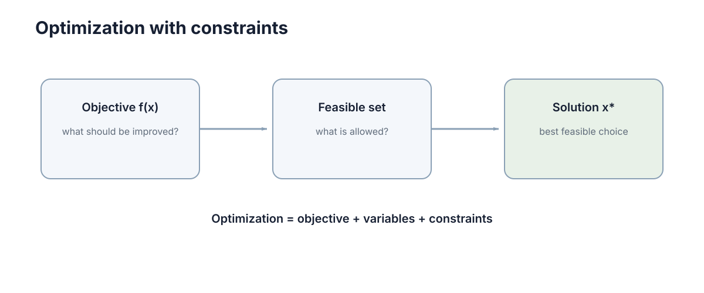
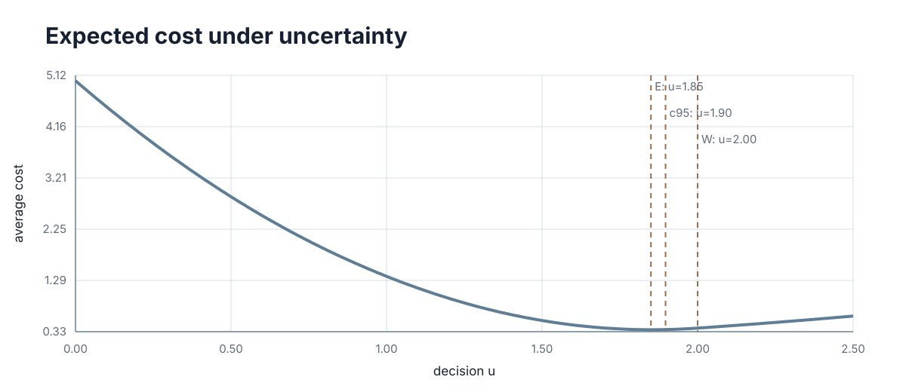

# Optimization, Constraints & Uncertainty

> 这一章讲的事你每天早上都在做，只是没把它写成数学。读完你应该能自己推出三件事：为什么"往最陡的方向走"是唯一不靠猜的选择、为什么约束会把最优解钉死在边界上、以及为什么当参数有 20% 的误差时，一个报到小数点后三位的最优值其实是误导。

---

## 一、导入例子

早上 7:40 出门，要在 7:55 前到公司。你站在楼下做的其实是一连串决策：

1. **你在挑"可以自己决定的量"**：骑哪条路、要不要绕高架、骑多快。这些是你能动的。
2. **你在比"哪条更好"**：更快，或者更省力，或者更不容易迟到。你需要一个能比较大小的数，否则"绕高架"和"走小路"根本没法比。
3. **有些事你不敢碰**：红灯不能闯、限高桥不能上、电量只够 8 km。这些不是你"希望"遵守，而是**必须**遵守。

把这三条写成数学，就是决策变量、目标函数、约束。**优化不是一门新工具，而是把"我想更好"这句话拆成三样东西：能动的、要好的、不能碰的。**

整章都沿着这三样走：第三节讲怎么把好坏压成一个数，第四节讲怎么一步步改进，第五、六节讲"停下来"和"不能碰"分别会怎样把答案改掉，第七节把"不能碰"翻译成一张报价单，第八节处理"参数本身就不知道"。

---

## 二、网格搜索的局限

最直接的办法是穷举：把所有能选的值一个个试一遍，挑最好的。

它坏在什么地方，看一个具体场景。假设你有 10 个可调的参数，每个参数合理地试 5 个取值——听起来很少。可 $5^{10}$ 是 976 万次；每个参数试 10 个取值，就是 100 亿次。**尝试次数随参数个数指数增长，而不是线性增长**，这就是维数灾难。所以任何"把格子划细一点再暴力搜"的想法，在 5 个变量以上就自动失效。

第二个更隐蔽的坏处：即使你愿意暴力搜，你也得先能回答"这一组取值比那一组好多少"。如果目标里同时有"更快"和"更省电"，一快一省怎么比大小？

于是被迫做两件事：

1. 把"好不好"压成一个**可以比较大小的标量**；
2. 不再穷举，而是**从当前值出发找一个方向走一小步，让这个标量变小**，然后重复。

第 1 件是第三节，第 2 件是第四节。两件事合起来就是"数值优化"的全部骨架。

---

## 三、目标函数（Objective Function）

先看结论的形状，再回头拆每一项：

$$
\min_x\ f(x)\quad \text{s.t.}\quad g_i(x)\le 0\ (i=1,\dots,m),\qquad h_j(x)=0\ (j=1,\dots,p).
$$

术语第一次出现当场拆开：

- **决策变量（decision variable）$x$**：真正允许你去选的那些量，$x\in\mathbb{R}^n$。
- **目标函数（objective function）$f$**：把一组选择映射成一个数，约定越小越好。
- **不等式约束（inequality constraint）$g_i(x)\le 0$**：软边界，可以贴上去，不能越过去。
- **等式约束（equality constraint）$h_j(x)=0$**：硬等式，必须精确满足。
- **可行域（feasible set）**：同时满足全部约束的 $x$ 组成的集合。注意它**先于目标函数**存在——它决定"哪些解有资格被比较"。

<figure markdown="span">
  
  <figcaption markdown="span">目标函数决定"好坏"，约束决定"哪些解允许被选择"。</figcaption>
</figure>

| 组成 | 数学对象 | 建模时必须先回答什么 |
| --- | --- | --- |
| 决策变量 $x$ | $x\in\mathbb{R}^n$ | 是否含整数或离散量？ |
| 目标函数 $f$ | $f:\mathbb{R}^n\to\mathbb{R}$ | 是标量，还是多项需要加权合并？ |
| 不等式约束 $g_i$ | $g_i(x)\le 0$ | 允许轻微违反吗？ |
| 等式约束 $h_j$ | $h_j(x)=0$ | 这些约束彼此独立吗？ |
| 可行域 | $g\le 0$ 与 $h=0$ 的交集 | 它非空吗？有界吗？ |

### 3.1 目标与约束

这是建模里最常见、代价也最大的一类错：把安全约束写成一个权重极大的惩罚项，塞进目标函数。

它为什么坏？**惩罚项只是把违反的代价抬得很高，并没有把违反变成不允许。** 当真实可行域是空集时（比如同时要求"距离大于 3 m"和"工作半径小于 2 m"），惩罚法会优雅地返回一个"违反最少"的解，而调用方拿到的是一个普通的最优值，**无法区分"这是可接受的近似"还是"这已经撞了安全红线"**。

正确的做法是按"违反了会怎样"给约束分类，再决定它进哪里：

| 约束性质 | 应该写成 | 违反时的系统行为 |
| --- | --- | --- |
| 物理上不可能违反 | 硬约束 | 报告不可行，不返回解 |
| 安全红线 | 硬约束 + 执行前检查 | 拒绝执行并切到安全策略 |
| 性能偏好 | 目标函数里的加权项 | 代价上升，结果仍可用 |
| 舒适度 | 正则项 | 轻微下降，不报警 |

一句话：**"希望"进目标函数，"绝不能"留在约束里。**

### 3.2 量纲与权重归一化

就算只留一个目标函数，还有第二个坑。假设目标里有两项，一项是距离、一项是温度，量纲分别是毫米和摄氏度，典型尺度差三个数量级。

你现在要调的就是这两个权重。数值上看起来"都是 1"，但距离项因为数值本身大 1000 倍，实际主导了整个目标函数。**于是你精心调的权重并没有在表达偏好，只是在补偿量纲。**

标准做法是归一化：每个变量先除以它的典型尺度，让各分量量级都接近 1，再谈权重。这一步不做，后面所有调参都只是在猜。

---

## 四、最速下降方向

现在有了标量目标，问题变成：站在 $x_k$ 上，往哪个方向走一小步能降得最多？

**老办法一：随机试方向。** 每次随机挑一个方向，好就接受。问题出在次数——在 $n$ 维空间里随机方向与真实下降方向的夹角期望就是 90°，几乎白走。

**老办法二：一次只调一个变量。** 这在窄谷地形里会走出之字形：沿 $x$ 走一步是下降的，沿 $y$ 走一步也是下降的，但两者合起来的方向才最陡，单独走任何一个都只是来回蹭。

**现在推一遍。** 对很小的位移 $\Delta x$，一阶泰勒近似给出

$$
f(x+\Delta x)\approx f(x)+\nabla f(x)^\top \Delta x .
$$

把位移长度固定住，即 $\|\Delta x\|=\varepsilon$，问哪个方向让右边最小——也就是最小化 $\nabla f(x)^\top\Delta x$。由 Cauchy–Schwarz 不等式，

$$
\nabla f(x)^\top \Delta x \ \ge\ -\|\nabla f(x)\|\,\|\Delta x\| ,
$$

等号当且仅当 $\Delta x$ 与 $-\nabla f(x)$ 同向时成立。

**所以"最陡下降方向就是负梯度"不是经验之谈，它是柯西–施瓦茨不等式取等号的条件。** 这就是梯度下降：

$$
x_{k+1}=x_k-\alpha\nabla f(x_k),
$$

$\alpha$ 叫**步长（step size）**。

### 4.1 步长的稳定性边界

定义梯度 Lipschitz 常数 $L$：$\|\nabla f(x)-\nabla f(y)\|_2\le L\|x-y\|_2$。对 Hessian 对称半正定的二次函数，$L=\lambda_{\max}(H)$；一般对称 Hessian 应取最大绝对特征值。下面三条只对正定二次函数的固定步长梯度法成立，不是任意光滑非凸函数的全局结论：

- $\alpha<2/L$：收敛；
- $\alpha<1/L$：每一步都单调下降；
- $\alpha>2/L$：最大特征值方向的放大因子绝对值大于 $1$，因此不能保证对任意初值收敛；只有初始误差含该不稳定方向分量时才会发散。若初值恰好落在仍满足 $|1-\alpha\lambda_i|<1$ 的不变子空间中，仍可能收敛。

| 步长情形 | 行为 | 失效模式 |
| --- | --- | --- |
| 远小于 $1/L$ | 每步下降与步长成正比 | 收敛慢，迭代次数与步长成反比 |
| 接近 $1/L$ | 常用且保证单调下降；不等于最优固定步长 | 要估 $L$，估小了就震荡 |
| 大于 $2/L$ | 至少最大特征方向不稳定 | 含该方向分量的初值会发散 |
| 固定且偏大 | 越过一阶近似有效区 | 最优点附近来回跳，永不收敛 |

这两条边界为什么长这样？因为一阶近似只在 $\varepsilon$ 很小时成立：步长越大，$\Delta x$ 越出近似的有效区，泰勒展开丢掉的二阶项开始占主导，符号可能整个反过来。第九节的实验一会把这件事跑给你看。

### 4.2 步长合适，方向也可能很差

**条件数（condition number）** $\kappa=\lambda_{\max}/\lambda_{\min}$ 衡量地形被拉长的程度。梯度法的误差大致每步乘 $(1-1/\kappa)$：$\kappa=100$ 时需要几百步，$\kappa=10^{6}$ 就是百万量级的迭代。

想摆脱它，就得用曲率信息。**牛顿法**把一阶近似升级成二阶：

$$
x_{k+1}=x_k-\big[\nabla^2 f(x_k)\big]^{-1}\nabla f(x_k).
$$

它用 Hessian 的逆把方向重新缩放，等价于把被拉长的谷拉圆。稠密直接法每步通常要做 $\mathcal O(n^3)$ 量级的线性代数。局部二次收敛通常要求解附近 Hessian 可逆并满足光滑性；正定 Hessian 是严格局部极小和 Newton 方向下降的常用充分条件，却不是局部极小存在的必要条件，例如 $f(x)=x^4$ 在 $0$ 处严格取极小而 $f''(0)=0$。Hessian 不正定时原始 Newton 方向未必下降，常用阻尼或信赖域修正。

---

## 五、驻点与全局最优性

局部最优只要求在某个邻域内没有更好的可行点：存在 $r>0$，使所有满足 $\|x-x^*\|\le r$ 的可行点都有 $f(x)\ge f(x^*)$。**全局最优**要求对可行域里所有点都成立，条件强得多。**两者的判据长得一模一样，只差"邻域"和"全体"这几个字——这就是所有麻烦的来源。**

| 地形特征 | 一阶条件表现 | 对求解器的影响 |
| --- | --- | --- |
| 局部极小 | 梯度为零且 Hessian 正定 | 迭代停止，通常是好结果 |
| 鞍点 | 梯度为零但 Hessian 有正有负 | 迭代停止，其实还能继续降 |
| 平坦区域 | 梯度范数接近零 | 相对步长过大，进展极慢 |
| 窄谷 | 某些方向曲率极大 | 条件数大，收敛缓慢 |
| 悬崖 | 梯度范数极大 | 步长须缩小，否则跳到远处 |

### 5.1 凸性与全局最优性

**凸集**要求连接任意两点的线段仍在集合内；**凸函数**要求弦在图像之上：

$$
f\big(tx+(1-t)y\big)\le t f(x)+(1-t)f(y),\qquad \forall x,y,\ t\in[0,1].
$$

对可微凸函数，这条定义等价于一个更好用的不等式：$f(y)\ge f(x)+\nabla f(x)^\top(y-x)$。

现在证明“凸问题的局部最优即全局最优”，这个证明同时覆盖边界上的约束最优点，不需要假设负梯度方向可行。

??? proof "证明"

    设凸可行集 $C$ 上的凸函数 $f$ 在 $x^*$ 处局部最优。若存在 $y\in C$ 使 $f(y)<f(x^*)$，由凸集定义，对任意 $t\in(0,1)$，$x_t=(1-t)x^*+ty\in C$。由凸性，

    $$
    f(x_t)\le(1-t)f(x^*)+tf(y)<f(x^*).
    $$

    当 $t\to0$ 时，$x_t\to x^*$，所以在 $x^*$ 的任意小邻域中都存在更小的可行函数值，与局部最优矛盾。因此不存在这样的 $y$，$x^*$ 是全局最优。

反过来，非凸问题只能退而求其次：多跑几次，每次换个初值（**重启**）。单次成功率为 $p$ 时，$k$ 次重启里至少成功一次的概率是

$$
1-(1-p)^k .
$$

$p=0.05$ 时，想达到 95% 的把握需要 59 次——代入验证：$1-0.95^{59}\approx 95.15\%$。也就是说，**一个成功率只有 5% 的方法，靠重启 59 次就能变成"几乎一定成功"，代价是 59 倍算力。**

### 5.2 高维空间的维数灾难

如果每个维度上平均有 $m$ 个局部极小，$d$ 维空间里大致有 $m^d$ 个。$m=3$、$d=20$ 就是 34.9 亿个坑。**在高维非凸问题里，"穷举验证全局最优"不是慢，而是原则上不可行**——这正是启发式方法和随机重启存在的原因：它们交付的是"当前最好解"，不是"最优解"。

---

## 六、约束下的可行方向

车辆的最快路径可能需要超速，机械臂的最短动作可能超过关节限位。约束一加上，第四节那句"负梯度就是下降方向"立刻失效——**因为沿负梯度走出的那一步，很可能直接走出了可行域。**

### 6.1 等式约束：梯度必须垂直于约束面

先看只有一个等式约束 $h(x)=0$ 的情形。只有在 $h$ 连续可微且当前点满足 $\nabla h(x)\ne0$ 时，隐函数定理才保证零水平集局部是一张 $n-1$ 维光滑曲面，$\nabla h$ 是其法向量。若梯度为零，例如 $h(x,y)=x^2+y^2=0$ 的原点，维数判断不能这样使用。

在曲面上移动只能沿**切向**。现在问：什么条件下切向再也降不下去？答案是——**目标函数的梯度在切向上没有分量**。因为只要切向分量不为零，就存在一个贴着曲面走的位移能降低 $f$，当前点就不是最优。

"梯度在切向上分量全为零"，等价于"梯度整个落在法向方向上"。而法向方向只有 $\nabla h$ 一个，于是

$$
\nabla f(x^*)+\lambda\nabla h(x^*)=0 .
$$

几何读法：**目标函数的等值线与约束曲面在最优点相切。** 如果两者是相交而不是相切，就说明还能沿曲面滑一段把目标压低——所以最优解一定落在"碰一下就走"的那个位置。

### 6.2 不等式约束与自由度账本

对 $g(x)\le 0$，只有**贴着边界**的那些才起作用。这把可行域劈成两半：在内部，约束可以当不存在，直接回到第四节；在边界上，可行方向变成半个空间，所有"往外走"的方向被禁掉。

**切空间与可行方向不能混为一谈。** 若 $p$ 个活跃等式约束的梯度线性无关，其切空间维数为 $n-p$。一个正则的活跃不等式通常把局部可行方向限制成这个切空间中的半空间或锥，却不把其线性维数减一；只有坚持沿边界移动时，边界切空间才少一维。因此不能用 $n-p-1$ 统一计算可行方向维数。

| $n$ | 等式约束 $p$ | 起作用的不等式 | 可行方向维数 | 含义 |
| --- | --- | --- | --- | --- |
| 2 | 0 | 0 | 2 | 平面上的自由点 |
| 2 | 0 | 1 | 2（半空间） | 可向内部移动，也可沿边界移动 |
| 2 | 0 | 2 | 视梯度方向而定（锥） | 可能仍有无穷多方向，也可能只剩零方向 |
| 2 | 1 | 0 | 1 | 只能在一条曲线上滑动 |
| 2 | 1 | 1 | 取决于两个约束梯度 | 不能只靠约束数量判断 |

最优点既可能在边界，也可能在内部；例如无约束函数 $\|x\|_2^2$ 在原点取得内部全局最小值。判断最优性的关键是所有可行方向上的一阶变化都不能为负，而不是“可行方向维数降到零”。

可行域本身的状态也得查，它决定求解器的输出该怎么解读：

| 可行域状态 | 求解器表现 | 应该采取的动作 |
| --- | --- | --- |
| 非空且内部有点 | 正常收敛到最优点 | 直接使用结果 |
| 非空但极薄 | 收敛慢，对数值误差敏感 | 松弛次要约束或提高精度 |
| 空集 | 报不可行，或返回最小违反解 | 查冲突约束，重排优先级 |
| 可行域无界 | 变量可沿某些方向无限移动；目标仍可能有有限最优值 | 分析目标在无界方向上的增长，不能仅凭无界判定无下界 |

第三行要特别小心。可把不等式正部平方和等式平方相加，定义全局最小违反量；只有在**已经求得全局最小值且该值严格大于零**时，才能证明原问题不可行。一般非凸求解器得到的正的局部最小值不是不可行证书。

---

## 七、拉格朗日乘子（Lagrange Multipliers）

第六节那个 $\lambda$ 到现在还只是个符号。它其实有一个可以直接算出来的含义。

看一维问题：$\min f(x)$，约束 $x\ge b$。当无约束驻点小于 $b$ 时，最优解落在边界 $x=b$ 上。把约束写成 $b-x\le 0$，构造拉格朗日函数

$$
\mathcal{L}(x,\lambda)=f(x)+\lambda(b-x).
$$

驻点条件 $\partial\mathcal{L}/\partial x=f'(x)-\lambda=0$ 立刻给出

$$
\lambda^*=f'(b).
$$

现在问：最优值 $f^*=f(b)$ 随下界 $b$ 怎么变？直接求导：

$$
\frac{df^*}{db}=f'(b)=\lambda^*.
$$

**所以乘子就是"把约束边界放松一个单位，目标值能改善多少"的价格。** 它不是数学技巧，它是一张报价单。

**数字例子。** $f(x)=(x-0.2)^2$，要求 $x\ge 0.5$。驻点 $0.2$ 不可行，最优解落在 $x=0.5$，于是 $\lambda^*=2(0.5-0.2)=0.6$。验证这张报价单：把下界从 0.5 放松到 0.49，最优值从 $0.09$ 变成 $0.0841$，改善 $0.0059\approx 0.6\times 0.01$——**与乘子预测的完全一致**（第九节的实验一会把这几个数再跑一遍）。

这个数字可以直接拿来做决策：**放松该约束的工程成本高于 0.6（每单位）就不值得放松；低于它，就该投钱去改约束。**

| 乘子取值 | 含义 | 决策提示 |
| --- | --- | --- |
| 等于零 | 互补松弛不能判断约束是否活跃 | 再检查约束余量；活跃约束也可能有零乘子 |
| 很小 | 边界代价低 | 约束容易满足，不必投硬件 |
| 很大 | 约束是主要瓶颈 | 改进它的收益最大 |
| 不唯一 | 常提示约束梯度相关或退化 | 只有证明删除后可行域不变，才能称约束冗余并删除 |

### 7.1 互补松弛条件（Complementary Slackness）

把目标和约束合起来，得到拉格朗日函数

$$
\mathcal{L}(x,\lambda,\nu)=f(x)+\sum_i\lambda_i g_i(x)+\sum_j\nu_j h_j(x).
$$

在目标与约束可微并满足适当约束资格条件（例如 LICQ）时，局部最优解满足 **KKT 条件**（Karush–Kuhn–Tucker）。对凸目标、凸不等式和仿射等式，配合 Slater 条件时，KKT 还成为充分条件；一般非凸问题中它只是一阶必要条件：

| 条件 | 数学形式 | 违反它意味着什么 |
| --- | --- | --- |
| 驻点条件 | $\nabla_x\mathcal{L}=0$ | 还能沿可行方向继续下降 |
| 原始可行 | $g_i(x^*)\le 0$、$h_j(x^*)=0$ | 解不在允许集合里 |
| 对偶可行 | $\lambda_i\ge 0$ | 约束方向写反了，把上界当成下界 |
| 互补松弛 | $\lambda_i g_i(x^*)=0$ | 非零乘子和非零余量同时出现，逻辑矛盾 |
| 约束资质 | 起作用约束的梯度线性无关 | 退化点，乘子可能不唯一 |

**互补松弛是最有信息量的一条**，它把第六节那句"要么可以当不存在、要么钉在边界上"写成了一个方程：$\lambda_i g_i=0$ 意味着两个因子至少有一个为零——余量为负（约束不起作用）时乘子必为零，乘子为正时余量必为零，两者同时非零是不可能的。

等式约束不参与互补松弛：它的乘子 $\nu_j$ 可以取任意符号，因为等式两侧都能被拉伸，不存在"哪边是允许的"这个问题。

---

## 八、不确定参数下的优化

到现在为止我们都默认模型是准的。可摩擦系数、用户需求、传感器误差这些量，你往往只知道一个范围或一个分布。

把它们显式写成参数 $\theta$，问题就变成**参数化优化**：

$$
\min_x\ f(x,\theta)\quad\text{s.t.}\quad g(x,\theta)\le 0,\qquad \theta\in\Theta .
$$

关键问题**不是"怎么算"，而是"$\theta$ 在什么时候被消掉"**：

| 消掉 $\theta$ 的时机 | 具体做法 | 输出形式 |
| --- | --- | --- |
| 优化时 | 代入标称值 | 单一解，可能非常脆弱 |
| 优化前 | 对 $\theta$ 取期望 | 平均意义下的最优解 |
| 优化后 | 先求标称解再做敏感性分析 | 解 + 风险报告 |
| 保留在约束里 | 要求 $\Theta$ 内所有取值都可行 | 保守解 |
| 保留为概率 | 机会约束 | 满足概率水平的安全解 |

一句话的警示：**不要把未知参数伪装成完全精确。** 如果某个参数的不确定范围达到标称值的 20%，而最优解又对它高度敏感，那么把结果报到小数点后三位就是误导——后两位完全落在噪声里，却会让下游以为精度可以依赖。

### 8.1 期望、最坏情形与机会约束

| 维度 | 期望型 | 最坏情况型 | 机会约束型 |
| --- | --- | --- | --- |
| 目标形式 | 最小化目标期望 | 最小化 $\Theta$ 内的最大目标 | 目标最小化，违规概率受限 |
| 需要的信息 | 分布或样本 | 只要参数边界 | 分布 + 概率水平 |
| 解的性质 | 平均最优 | 区间内处处可行 | 以给定概率可行 |
| 保守程度 | 低 | 高，可能过度保守 | 可调，介于两者之间 |
| 计算难度 | 中等，可用样本近似 | 常能转成确定性凸问题 | 高，一般非凸，需近似 |
| 典型失效 | 尾部事件被平均掉 | 参数其实总在内部，性能白浪费 | 概率水平选错，实际违规偏高 |
| 适用场景 | 大量重复决策 | 安全红线、一次性决策 | 允许小概率违规的资源分配 |

**期望型的问题出在尾部。** 若代价在极端参数下暴涨、但概率很小，期望值看起来仍然很好，而单次实际执行可能惨得多。常用的补救是条件风险价值（CVaR）：只对最差的那一部分情形取平均，于是对尾部敏感；而且在目标凸时仍然保持凸性，可以继续用第四节那套方法求解。

**最坏情况型的保守度可以量化。** 参数区间宽度为 $w$、目标对参数的敏感度为 $s$ 时，鲁棒解与标称解的目标差距大致按 $w\cdot s$ 增长。所以"为了保险把区间取大一点"会让代价线性放大——这是鲁棒优化被误用的主要形式。折中做法是只在真正影响安全的约束上做鲁棒化，其余项保持标称。

### 8.2 机会约束的价格，用分位数算得出来

对形如线性上界、且参数服从高斯的机会约束，可以精确转成二阶锥约束，安全裕度就是标准正态的分位数：

| 要求的可行概率 | 95% | 99% | 99.9% |
| --- | --- | --- | --- |
| 裕度系数（$\sigma$ 的倍数） | 1.645 | 2.326 | 3.090 |

这张表值得停一下：**概率要求从 95% 提到 99.9%，违规率降了 100 倍，而裕度只从 1.645 涨到 3.090（不到 2 倍）。** 尾巴上的可靠性是"超线性"换来的——这正是安全设计愿意把概率标准定得很严的原因。

**分布未知时**只能用样本近似，那就要算清楚样本量。一个常见误用是："我在 20 个采样场景上都测过可行，所以违规概率小于 1%。"这个推论不成立。要让"在 $N$ 个独立场景上全部可行"支撑住"违规概率小于 1%"，在 95% 置信水平下需要

$$
(0.99)^N\le 0.05\ \Longrightarrow\ N\ \ge\ \frac{\ln 0.05}{\ln 0.99}\approx 299 .
$$

**20 个场景离 299 差了一个数量级，所以那 20 个场景什么也证明不了。** 相关的鲁棒与安全建模细节见 [../robustness-safety/01-uncertainty-shift.md](../../safety-human-factors/robustness-safety/01-uncertainty-shift.md)。

### 8.3 参数敏感性

一阶敏感度由隐函数定理给出。对参数化问题，最优点满足一阶条件，把该条件对参数求全导数，得

$$
\frac{dx^*}{d\theta}=-\big[\nabla_{xx}^2 f\big]^{-1}\nabla_{x\theta}^2 f .
$$

式子里挂着一个 Hessian 的逆：**敏感度与 Hessian 的逆成正比，所以在"平坦方向"（Hessian 特征值小的方向）上，解的敏感度极大。** 曲率取 0.001，一个很小的参数扰动就会被放大上千倍地传到解上。带约束时敏感度与乘子直接相连：若约束写成上界而右端可调，则最优值对该边界的导数等于负的乘子——第七节那张报价单在这里又出现了一次。

| 敏感度来源 | 诊断量 | 高风险表现 |
| --- | --- | --- |
| 目标函数平坦 | Hessian 最小特征值 | 接近零，最优点几乎不可辨 |
| 约束紧贴 | 约束余量 | 接近零，微小扰动即不可行 |
| 参数不确定 | 区间宽度 × 敏感度 | 解的范围跨越多个不同决策 |
| 离散化误差 | 步长 × 梯度 | 步长不减小则解不收敛 |

工程上的判据：**参数在标称值 ±10% 内变动时，最优解的变动不超过 20%，这个解才算稳健**；否则就该改用保守解，或者加在线反馈。把"最优"扩展成"对合理扰动仍然可接受"，才是能交付的方案。

---

## 九、约束与不确定性实验

### 9.1 一维约束问题中的边界与步长

下面这段只依赖 numpy，做三件事：算出第三节表格里每种情形的驻点与边界最优、把第七节那张报价单的数字验一遍、再用同一个问题把第四节的步长边界跑出来。

```python
import numpy as np

# 一维问题：J(u) = (u-c)^2 + 0.1u^2  ->  J'(u) = 2.2u - 2c，曲率 L = 2.2
def J(u, c):   return (u - c) ** 2 + 0.1 * u ** 2
def dJ(u, c):  return 2.2 * u - 2.0 * c

print("① 驻点 c/1.1，以及可行域 [-1, 1] 上的最优解")
for c in (0.35, 1.8, -2.0):
    us = c / 1.1
    ub = min(1.0, max(-1.0, us))          # 驻点越界就投影到最近的边界
    tag = "不起作用" if abs(ub - us) < 1e-12 else "起作用"
    print(f"   c={c:>5}  驻点={us:+.3f}  驻点可行={-1 <= us <= 1}  "
          f"最优u={ub:+.3f}  J={J(ub, c):.4f}  约束{tag}")

print("② 报价单：min (x-0.2)^2 s.t. x >= 0.5")
lam = 2 * (0.5 - 0.2)
gain = (0.5 - 0.2) ** 2 - (0.49 - 0.2) ** 2
print(f"   lambda*={lam:.3f}   下界 0.5->0.49 的实际收益={gain:.4f} "
      f"(lambda* x 0.01 = {lam * 0.01:.4f})")

print("③ 步长：u0=5.0，L=2.2，收敛门槛 1/L=0.4545，发散门槛 2/L=0.909")
ustar = 0.35 / 1.1
for a in (0.10, 0.45, 0.90, 1.00):
    u, k = 5.0, 0
    for k in range(1, 2001):
        u -= a * dJ(u, 0.35)
        if abs(u - ustar) < 1e-6:
            break
    if abs(u) > 1e6:
        print(f"   alpha={a:<5} 迭代 {k:>4} 次  u={u:+.3e}  -> 发散")
    else:
        print(f"   alpha={a:<5} 迭代 {k:>4} 次  u={u:+.6f}  J(u)={J(u, 0.35):.6f}")
```

跑出来是这样：

```text
① 驻点 c/1.1，以及可行域 [-1, 1] 上的最优解
   c= 0.35  驻点=+0.318  驻点可行=True  最优u=+0.318  J=0.0111  约束不起作用
   c=  1.8  驻点=+1.636  驻点可行=False  最优u=+1.000  J=0.7400  约束起作用
   c= -2.0  驻点=-1.818  驻点可行=False  最优u=-1.000  J=1.1000  约束起作用
② 报价单：min (x-0.2)^2 s.t. x >= 0.5
   lambda*=0.600   下界 0.5->0.49 的实际收益=0.0059 (lambda* x 0.01 = 0.0060)
③ 步长：u0=5.0，L=2.2，收敛门槛 1/L=0.4545，发散门槛 2/L=0.909
   alpha=0.1   迭代   62 次  u=+0.318183  J(u)=0.011136
   alpha=0.45  迭代    4 次  u=+0.318182  J(u)=0.011136
   alpha=0.9   迭代  761 次  u=+0.318181  J(u)=0.011136
   alpha=1.0   迭代 2000 次  u=+1.079e+159  -> 发散
```

### 9.2 实验二：三条路线用同一个不确定性比一比

第八节那张三路线对比表说的是"差别在哪种失败更不可接受"。把它变成一个能算的场景：需求 $\theta$ 只知道落在 $[0,2]$ 里，备货量 $u$ 必须提前定死。冗余要花钱、缺口要罚钱，于是一个典型的权衡。

```python
import numpy as np

# 需求 theta ~ U[0,2]，备货量 u 必须提前定死
# 代价 = 冗余成本 0.1u^2 + 缺口罚金 5*max(0, theta - u)
rng = np.random.default_rng(7)
N = 20000
theta = rng.uniform(0.0, 2.0, N)
grid = np.arange(0.0, 2.501, 0.01)

def cost(u, th):
    return 0.1 * u ** 2 + 5.0 * np.maximum(0.0, th - u)

C = cost(grid[:, None], theta[None, :])       # 每行是一个候选 u 在所有样本上的代价

def report(name, u):
    c = cost(u, theta)
    print(f"   {name:<14} u={u:.3f}  平均代价={c.mean():.4f}  "
          f"最坏代价={c.max():.4f}  违规率={np.mean(theta > u):>7.2%}")

print("同一个不确定性，五条路线选出的 u 完全不同：")
report("标称 theta=1", 1.0)
report("期望型", grid[C.mean(axis=1).argmin()])
report("最坏情况型", grid[C.max(axis=1).argmin()])
report("机会约束 95%", np.quantile(theta, 0.95))
report("机会约束 99%", np.quantile(theta, 0.99))
```

跑出来是这样：

```text
同一个不确定性，五条路线选出的 u 完全不同：
   标称 theta=1     u=1.000  平均代价=1.3670  最坏代价=5.0990  违规率= 50.42%
   期望型            u=1.850  平均代价=0.3698  最坏代价=1.0913  违规率=  7.47%
   最坏情况型          u=2.000  平均代价=0.4000  最坏代价=0.4000  违规率=  0.00%
   机会约束 95%       u=1.897  平均代价=0.3726  最坏代价=0.8750  违规率=  5.00%
   机会约束 99%       u=1.978  平均代价=0.3920  最坏代价=0.4983  违规率=  1.00%
```



---

## 十、常见错误

出了怪现象不用猜，按症状反查：

| 你看到的现象 | 最可能的原因 | 先验证什么 |
| --- | --- | --- |
| 迭代到一半就不动了，梯度很小 | 落在平坦区或鞍点 | Hessian 有无负特征值；换个初值重启 |
| 目标值每步都在上升 | 步长超过 $2/L$ | 估一下 $L$，把 $\alpha$ 减半 |
| 窄谷里之字形慢爬 | 条件数太大 | 变量归一化了吗；要不要上二阶或预处理 |
| 求解器说"最优"，方案却越了安全线 | 安全约束被写成了惩罚项 | 可行域是否为空；有没有做不可行性检验 |
| 参数一换，解就跑很远 | 平坦方向 + 参数不确定 | Hessian 最小特征值；敏感度乘区间宽度 |
| 20 个场景都通过，上线还是违规 | 样本量不足 | 要 1% 的保证，样本量够 299 吗 |
| 放松了约束，收益远小于预期 | 约束可能不活跃，也可能是零乘子的退化活跃约束 | 同时检查 $\lambda$、约束余量和二阶变化 |

---

## 十一、核心结论

- **为什么必须用梯度**：穷举的代价随维数指数爆炸，而"最陡下降方向是负梯度"不是经验，是柯西–施瓦茨不等式取等号的条件——它是在"不许猜"的前提下唯一被推出来的方向。
- **为什么约束会改变答案**：约束删去了一部分下降方向；最优点一般仍有非零可行方向，只是沿这些方向的一阶变化不能降低目标。满足敏感性条件时，乘子 $\lambda$ 给出边界小幅变化对最优值的一阶影响。
- **为什么不确定时必须换问法**：期望、最坏情况、概率是三种不同的承诺，代价不同、失败方式也不同。把未知参数当作已知，是这个领域里最贵的一类错误。

> **下一步**：这一章讲的是"模型已知、一次性求解"的优化。当系统必须在线、滚动地反复求解，而且每一次的解都受上一刻状态的约束时，优化就变成了控制——[Modeling & State Space](../control-theory/01-modeling-state-space.md) 会告诉你"状态"是怎么被写进模型、又是怎么把一串静态优化串成一条时间线的。
