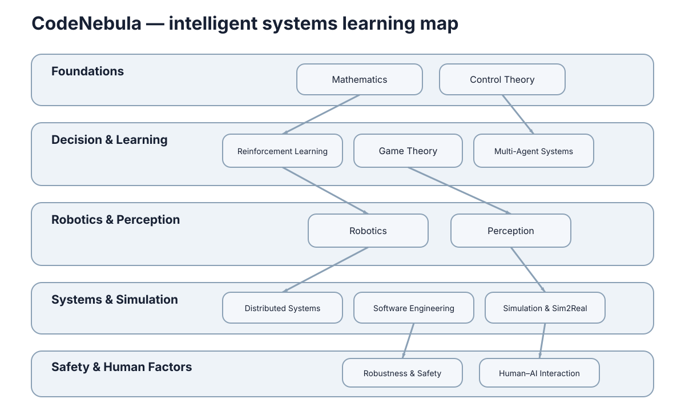

# CodeNebula

CodeNebula 是一套面向零基础读者的智能系统讲解手册。它从“一个量是什么、为什么要这样表示、怎样一步步算出来”开始，再进入控制、学习、机器人、感知和真实系统。读者不需要先熟悉教材里的术语，但需要按章节给出的前置顺序学习并亲手复算例题。

<figure markdown="span">
  
  <figcaption>手册按基础、决策学习、机器人感知、系统仿真、安全与人因五个领域组织。</figcaption>
</figure>

本手册只保留后文确实需要的前置知识。一个知识点若会被后文使用，就在首次系统出现时给出定义、推导、数字例子、适用条件和常见错误；若后文不用，则不为追求“知识完整”而提前罗列。代码用于验证已经解释过的计算或展示工程接口，不代替数学过程。

## 学习结构

手册不要求所有读者走同一条路线，但领域之间存在明确的前置关系。数学基础是多数理论章节的共同入口；控制理论支撑机器人控制；概率、优化和机器学习支撑感知与强化学习；系统、安全和人机协作章节则把算法放进真实运行环境。

| 领域 | 包含 Section | 回答的问题 | 需要的前置 |
|---|---|---|---|
| 基础 | 数学、控制理论 | 系统如何表示、公式如何计算、方法在什么条件下成立 | 从数学第一页开始 |
| 决策与学习 | 机器学习、强化学习、博弈论、多智能体系统 | 如何从数据学习并在交互中连续决策 | 数学基础；强化学习还需要机器学习 |
| 机器人与感知 | 机器人学、计算机视觉与三维感知 | 如何理解传感器数据并让机器人运动 | 数学基础；控制章节按需 |
| 系统与仿真 | 分布式系统、软件工程、仿真与现实迁移 | 如何让算法成为可运行、可观察、可恢复的系统 | 至少先掌握一个应用方向 |
| 安全与人因 | 鲁棒性与安全、人机协作 | 条件变化、组件失效或与人协作时如何保持可接受行为 | 建议先完成一个应用方向 |

全站当前包含 13 个主题 Section、64 篇正文和 13 篇主题导读。页面数量不是学习目标；是否掌握以“能解释符号、能独立复算例题、能说明方法失效条件”为准。

前置关系不是为了设置门槛，而是为了让后面的内容有落脚点。例如 Control Theory 里的稳定性概念会反复出现在 Robotics 的控制回路和 Safety 的降级策略中；Mathematics 里的概率语言会出现在 Perception 的估计与 Robustness 的分布变化里。缺少这些落脚点，后面的内容就只剩结论。

因此这张表更准确的用法是反向查：当你在某个章节读不下去时，回到这张表确认它的前置是否已经建立，而不是继续硬读。

## 五个领域的职责

每个领域存在的理由，是它解决了一类别的领域不解决、又无法回避的问题。下面按“领域 → 典型问题 → 缺失后果”给出导航级的对应关系。

| 领域 | 它解决的典型问题 | 缺失后会怎样 |
|---|---|---|
| 基础知识 | 如何把系统写成可分析的状态模型、如何判断反馈是否稳定 | 后续方法只有实现，没有成立条件 |
| 决策与学习 | 如何在不确定与交互中做序贯决策、多主体如何协调 | 会把“规划”当成一次性求解 |
| 机器人与感知 | 如何从传感器获得位姿、地图与环境理解 | 算法无法落到有噪声的物理世界 |
| 系统与仿真 | 如何让算法在真实时延、故障与部署下运行 | 单机 demo 无法变成系统 |
| 安全与人因 | 条件变化、组件失效、与人协作时如何保持可接受行为 | 事故只在最坏情况暴露 |

需要强调的是，这不是“先学完再实践”的顺序说明，而是“最短可交付”的依赖说明：当某个问题无法定位是哪一层出错时，通常是因为对应的领域没有被建立。

| 领域 | 入门信号 | 常见卡点 |
|---|---|---|
| 基础知识 | 能把一个控制问题写成状态空间与目标函数 | 把线性假设忘在推导之外 |
| 决策与学习 | 能写出一个 MDP 并解释 Bellman 递推 | 混淆值函数与策略 |
| 机器人与感知 | 能解释一次估计更新的依据 | 忽略传感器标定与坐标系 |
| 系统与仿真 | 能画出组件之间的数据流与失败点 | 忽略时延与时钟一致性 |
| 安全与人因 | 能写出系统的责任矩阵与恢复路径 | 把安全当成事后补的功能 |

一个领域被真正建立起来的标志，不是记住术语，而是能对领域的典型问题给出机制层面的解释，并知道它在什么条件下失效。
所以判断自己是否“学过”某个领域，最省事的检验方法是尝试回答它那一行的典型问题，若只能复述结论而说不出条件，说明这一层还需要补。
这也解释了为什么本课程把失败模式表放在与公式同等的位置：条件与边界才是可迁移的部分。

## 主题与前置知识

| 主题 | 学到的核心能力 | 前置知识 |
|---|---|---|
| 数学基础 | 向量、矩阵、概率、优化与数值误差的逐步计算 | 无 |
| 控制理论 | 动态模型、反馈、稳定性、PID、LQR 与 MPC | 线性代数、导数 |
| 机器学习 | 损失、梯度、反向传播、CNN、RNN 与 Attention | 向量、导数、概率 |
| 强化学习 | MDP、Bellman 递推、值方法与策略优化 | 概率、机器学习 |
| 博弈论与多智能体 | 策略、均衡、协调、通信与任务分配 | 概率；强化学习按需 |
| 机器人与感知 | 坐标变换、状态估计、SLAM、规划、图像与点云 | 数学基础；控制理论按需 |
| 系统与仿真 | 通信、时间、测试、部署、物理仿真与现实迁移 | 至少一个应用主题 |
| 安全与人因 | 风险、约束、故障、共享控制与接管 | 至少一个应用主题 |

## 学习路线

第一次接触智能系统时，从[数学基础](foundations/mathematics/index.md)开始。向量、矩阵、导数和概率分别支撑后面的状态表示、线性化与不确定性计算。

完成数学基础后，可以按目标选择主线：

- 控制与机器人：数学基础 → 控制理论 → 机器人学 → 感知 → 安全；
- 学习与决策：数学基础 → 机器学习 → 强化学习 → 博弈论 → 多智能体系统；
- 感知与三维视觉：数学基础 → 机器学习 → 图像与相机 → 特征、检测、深度与点云；
- 系统工程：先完成任意一条应用主线，再读分布式系统、软件工程和仿真。

如果某一页出现无法解释的符号，不要把它当作需要背下来的记号。先沿页面中的前置链接返回定义页，完成对应的数字例子，再继续当前章节。

## 章节学习方法

每个知识点应完成四件事：

1. 说出输入、输出、维度和单位；
2. 跟随正文独立复算一次数字例子；
3. 说明公式依赖的假设；
4. 指出假设失效时会出现什么现象。

公式后的代码用于验证结果。第一次学习时应先手算，再运行代码对照；如果两者不同，先检查符号、维度、单位和坐标系，而不是直接相信程序输出。

## 领域之间的接口与横切主题

五个领域之间并非只有垂直依赖，还有大量横向接口。横切主题的特点是：它们不归属于任何单一领域，却会在每个领域里以不同形式出现，一旦被忽略就会在集成阶段集中爆发。

| 横切主题 | 主要出现位置 | 不处理的后果 |
|---|---|---|
| 时延与实时性 | 控制回路、分布式系统、人机交接 | 理论正确的策略在时间上不可行 |
| 不确定性表达 | 概率与估计、感知、鲁棒性与安全 | 决策缺少可信的置信度依据 |
| 表示与坐标系 | 数学、机器人、感知、仿真 | 模块间几何关系错位 |
| 失效与降级 | 控制、分布式系统、安全与人因 | 单点失效放大为系统失效 |

这些接口对应的入口链接如下，导航级地标记了各自最需要被前置建立的部分：

| 接口 | 建议入口 | 你要带走什么 |
|---|---|---|
| 表示与数学语言 | [Mathematics](foundations/mathematics/index.md) | 空间、概率与优化的统一符号 |
| 反馈与稳定性 | [Control Theory](foundations/control-theory/index.md) | 回路与稳定条件 |
| 序贯决策 | [Reinforcement Learning](decision-learning/reinforcement-learning/index.md) | 状态、收益与更新规则 |
| 策略互动 | [Game Theory](decision-learning/game-theory/index.md) | 均衡与最优应对 |
| 多主体协调 | [Multi-Agent Systems](decision-learning/multi-agent-systems/index.md) | 通信与任务分配 |
| 本体与运动 | [Robotics](robotics-perception/robotics/index.md) | 从模型到规划控制 |
| 环境理解 | [Perception](robotics-perception/perception/index.md) | 从图像到位姿与语义 |
| 系统与容错 | [Distributed Systems](systems-simulation/distributed-systems/index.md) | 时延、一致性与故障处理 |
| 工程化与部署 | [Software Engineering](systems-simulation/software-engineering/index.md) | 接口、测试与可靠性 |
| 仿真与现实迁移 | [Simulation & Sim2Real](systems-simulation/simulation-sim2real/index.md) | 仿真到真机的差距来源 |
| 鲁棒与安全 | [Robustness & Safety](safety-human-factors/robustness-safety/index.md) | 不确定性、约束与故障 |
| 人机协作 | [Human–AI Interaction](safety-human-factors/human-ai-interaction/index.md) | 控制权、信任与接管 |

判断横切主题是否被处理过，可以用一个简单问题自检：当某个条件变化（时延增大、置信度下降、坐标系不一致、组件失效）时，系统会表现出什么？答不上来，通常说明对应的横切接口还没有被设计。

!!! note "内容边界"
    每个 Section 只保留能连接上下游的核心概念。代码只出现在工程实现与真实系统；图片优先使用几何解释图、状态空间图、概率关系图、优化曲面图、架构图、数据流图、系统连接图和实验结果图。

> **下一步**：第一次来建议从 [Mathematics](foundations/mathematics/index.md) 开始；若目标是做机器人系统，可直接进入 [Robotics](robotics-perception/robotics/index.md) 的导读页确认前置需求；若关注人机协作，则可从 [Human–AI Interaction](safety-human-factors/human-ai-interaction/index.md) 进入。

