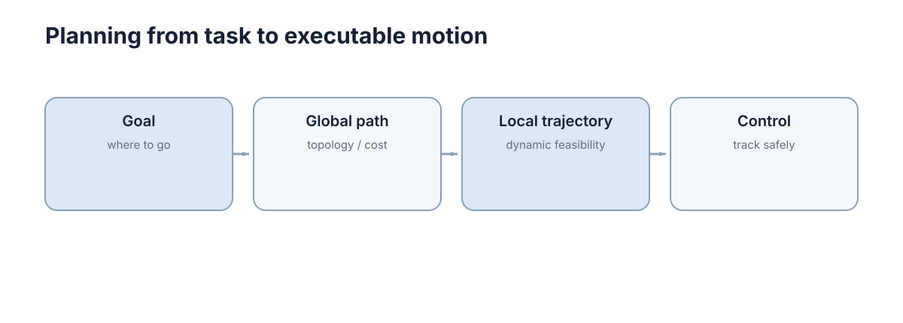

# Path & Motion Planning

> 在方格地图上，从左下角走到右上角，可以只问“哪些格子能走”，A* 很容易给出一条路径；但真实小车有最小转弯半径、最大速度和加速度，路径上的尖角可能根本转不过去。
>
> 所以先把“几何上能连通”与“动力学上能执行”分开。路径规划解决前者，运动/轨迹规划把时间和车辆约束加回来。本章按这两层逐步推进。

<figure markdown="span">
  
  <figcaption markdown="span">地图只给出环境，规划还必须考虑碰撞、运动约束和代价。</figcaption>
</figure>

## 图搜索适合已经离散化的空间

栅格地图中，每个格子可以看作节点，相邻可通行格子之间形成边。Dijkstra 根据累计代价扩展节点；A* 在此基础上加入启发函数 $h(n)$，优先搜索更可能靠近目标的方向：

$$
f(n)=g(n)+h(n).
$$

这里 $g(n)$ 是当前已找到的起点到节点 $n$ 的最小候选代价；节点按正确条件从队列弹出后，这个值才会被最终确认。$h(n)$ 是对 $n$ 到目标剩余代价的估计。在边权非负、启发函数不高估、并对不一致启发正确处理节点重新打开的前提下，A* 能保持最优性，同时通常比 Dijkstra 少扩展无关区域。

离散化本身有两个容易忽略的参数：

- **栅格分辨率** $r$：$r$ 取小则路径精细、计算量与内存按 $O(r^{-2})$ 增长；$r$ 取大则窄通道可能被“抹平”，出现假不可达。
- **连通度**：4 邻域只能走水平或垂直。以欧氏最短距离为分母，最坏方向是 $45^\circ$，此时相对超长比例为 $\sqrt2-1\approx41.4\%$；8 邻域允许对角，最坏相对误差约为 $8.2\%$，代价是转弯更生硬。

因此“图搜索能用”的前提是：**环境的空间维度和分辨率已经让状态空间可枚举。** 一旦维度升到 7 自由度机械臂，直接网格化的节点数是 $O(r^{-7})$，这条路线就崩了。

另一个容易吃亏的地方是**边的代价定义**。同一张栅格图，边的权重取法不同，搜索出来的路径风格完全不同：

| 代价定义 | 表达式 | 得到的路径 | 副作用 |
| --- | --- | --- | --- |
| 纯长度 | $w=\lVert v-u\rVert$ | 最短，常贴障碍 | 离障碍零余量 |
| 长度 + 障碍惩罚 | $w=\lVert v-u\rVert\,(1+\lambda c_v)$ | 走通道中线 | $\lambda$ 大时绕远 |
| 长度 + 转弯惩罚 | $w=\lVert v-u\rVert+\mu\,\lvert\Delta\theta\rvert$ | 少拐弯、更平滑 | 需要把朝向纳入状态 |
| 长度 + 地形代价 | $w=\lVert v-u\rVert\,(1+\lambda(c_v+c_{v\to u}))$ | 绕开坡道/草地 | 参数多、难标定 |

其中 $c_v\in[0,1]$ 是节点 $v$ 的代价地图取值（0 表示完全自由，1 表示致命障碍），$\lambda\ge 0$ 是惩罚强度。**只要 $c_v\ge 0$，这类加权代价仍然非负，A* 的可采纳性条件不受影响**；但如果为了“抄近道”允许负代价，Dijkstra 与 A* 的最优性证明立刻失效。

工程上还有两个实现细节直接影响扩展节点数：用**开放列表（open list）** 保存待扩展节点、**封闭列表（closed list）** 记录已定型节点，能避免重复入队；当多条路径代价相等时，按 $h$ 值做 tie-breaking（优先扩展 $h$ 更小的）通常会改变扩展顺序，并可能减少扩展节点数。减少幅度依赖地图、启发函数和重复节点处理策略，不能写成脱离实验条件的固定百分比；在一致启发函数和正确实现下，这种平局处理不改变最优性。

## 图搜索与启发函数

三种最常用变体的差别只在优先级函数的构造，但工程后果差别很大。

| 算法 | 优先级 $f(n)$ | 最优性 | 完备性 | 示意性的相对扩展量 |
| --- | --- | --- | --- | --- |
| Dijkstra | $g(n)$ | 最优 | 完备 | 通常最多 |
| A* | $g(n)+h(n)$，$h$ 可采纳 | 最优 | 完备 | 随启发函数变紧而减少 |
| 加权 A*（$\varepsilon=1.5$） | $g(n)+1.5\,h(n)$ | 有界次优 | 完备 | 通常少于 A* |
| 贪婪最佳优先 | $h(n)$ | 不保证 | 有限图上完备 | 可能很少，但可能严重绕路 |

上表只表达算法之间常见的相对趋势，不是某张未提供生成代码的地图上的测量结果。实际扩展节点数必须同时报告地图、邻接规则、启发函数、平局策略、重复节点处理和随机种子。加权 A* 的可证明结论是解代价满足相应的次优上界，而不是扩展节点数必然下降某个固定比例。

启发函数的两个性质决定结论：

- **可采纳性（admissible）**：对所有节点 $h(n)\le h^{*}(n)$，即永不高估。在非负边权和正确重复节点处理下，可采纳启发使 A* 返回最优解。$h\equiv 0$ 时 A* 退化成 Dijkstra。
- **一致性（consistent / monotone）**：$h(n)\le c(n,n')+h(n')$。一致性是可采纳的充分条件，且保证每个节点最多被扩展一次；不一致但可采纳的启发函数仍最优，但可能重复扩展节点。

??? proof "A* 在可采纳启发下的最优性"
    设最优路径代价为 $C^*$，目标节点第一次从开放列表弹出时的代价为 $C$。在目标弹出以前，任一尚未完全展开的最优路径上总有一个前沿节点 $n$。因为到该节点的当前最佳代价不超过最优路径前缀代价 $g^*(n)$，且 $h$ 可采纳，

    $$
    f(n)=g(n)+h(n)\le g^*(n)+h^*(n)=C^*.
    $$

    目标节点的启发为零，所以它的优先级是 $f(goal)=C$。A* 总弹出最小优先级节点，因此 $C\le C^*$；另一方面任何完整路径代价都不小于最优值，故 $C\ge C^*$，于是 $C=C^*$。若不一致启发导致某节点找到更小 $g$，实现必须允许重新打开该节点，才能维持“当前最佳代价”的前提。

常用启发函数的紧致程度：

| $h$ | 表达 | 可采纳条件 | 说明 |
| --- | --- | --- | --- |
| 曼哈顿 | $\lvert\Delta x\rvert+\lvert\Delta y\rvert$ | 仅 4 邻域 | 8 邻域下高估，破坏最优性 |
| 欧氏 | $\sqrt{\Delta x^2+\Delta y^2}$ | 任意邻域 | 对 8 邻域偏松，扩展更多 |
| 对角（octile） | $\max(\Delta x,\Delta y)+(\sqrt{2}-1)\min(\Delta x,\Delta y)$ | 8 邻域且对角代价 $\sqrt{2}$ | 实践中扩展最少 |
| 分离式（landmark） | 由地标预计算下界 | 需预计算 | 需换内存换离线时间 |

**启发函数越紧，通常需要扩展的候选区域越小。** 在均匀代价栅格上，可把 A* 的候选区域近似理解成一个以起点和终点为焦点的区域；启发越松，这个区域越宽。即使 $h=h^*$，若存在多条等长路径，平局策略仍可能扩展多个满足 $f=C^*$ 的节点，不能绝对地说“只扩展一条路径”。当 $h=0$ 时算法退化成 Dijkstra；在目标从优先队列弹出前，它通常处理的是起点代价不超过最优目标距离 $C^*$ 的节点，而不是无条件扩展整个可达区域。

加权 A* 引入次优上界：若 $h$ 可采纳，$f=g+\varepsilon h$ 搜索得到的解满足

$$
C\le \varepsilon\cdot C^{*},
$$

即最坏情况下路径代价是最优的 $\varepsilon$ 倍。$\varepsilon=1.5$ 时理论上允许最多 50% 的额外代价；实际差距取决于地图、启发函数和平局策略，不能脱离实验条件给出固定百分比。**次优界是上界，不是期望值。**

## 采样规划适合高维连续空间

机械臂有很多关节，自由空间难以完整离散化。RRT 一类方法通过随机采样逐步构造可达树，不需要先显式建立整个配置空间网格。

其核心流程是：每次随机取一个配置 $q_{\text{rand}}$，找到树中距离最近的节点 $q_{\text{near}}$，沿连线朝 $q_{\text{rand}}$ 前进固定步长 $\delta$ 得到 $q_{\text{new}}$，若这段线段无碰撞则加入树中。因此搜索树是**边探索边生长**的，而不是预先存在的。

这一族方法不需要完整枚举高维配置空间，因此在网格法难以承受的高维问题中仍可能实用。若用平衡空间索引，单次最近邻查询平均可接近 $O(\log n)$；这不是整个规划过程的碰撞检测复杂度。每次扩展通常至少要检查一条候选边，运行到 $n$ 次采样时碰撞检测调用量通常随尝试次数近似线性增长，而每次检测本身的代价还取决于机器人几何、边离散精度和障碍数量。RRT 不保证最优，且每次运行结果不同。

“配置”在这里有严格含义：配置 $q$ 是完整描述机器人形态的广义坐标，$d$ 自由度机械臂的配置空间 $\mathcal{C}$ 是 $d$ 维流形，障碍区 $\mathcal{C}_{\text{obs}}$ 是那些会让机器人发生碰撞的配置集合。规划的目标是找到一条完全落在自由空间

$$
\mathcal{C}_{\text{free}}=\mathcal{C}\setminus\mathcal{C}_{\text{obs}}
$$

内的连续曲线。碰撞检测看的是**整条边** $q(s)=(1-s)q_{\text{near}}+s\,q_{\text{new}},\ s\in[0,1]$，而不是两个端点——这是采样规划里最容易被实现错的地方，也是“路径穿墙”的典型来源。

采样规划与图搜索的对照可以一句话记住：**图搜索先有离散图再搜索；采样规划边探索边构图。** 前者需要显式枚举状态，后者只需要一个能回答“这两个配置之间的运动是否碰撞”的碰撞检测函数。

## 采样规划与概率完备性

| 方法 | 完备性 | 最优性 | 适合的空间维度 | 参数敏感性 | 典型用途 |
| --- | --- | --- | --- | --- | --- |
| RRT | 概率完备 | 无 | 中高维（5–30） | 步长 $\delta$ 敏感，结果随机 | 快速找一条可行路径 |
| RRT* | 概率完备 | 渐近最优 | 中高维 | 更敏感，需大量采样才收敛 | 质量要求高的机械臂规划 |
| PRM | 概率完备（对特定采样） | 基础版无，PRM* 渐近最优 | 中高维、**静态**环境 | 采样点数量 $N$ 敏感 | 多次查询的固定环境 |
| 网格 A* | 完备（分辨率内） | 最优 | 低维（2–3） | 分辨率敏感 | 移动机器人二维导航 |

**概率完备性（probabilistic completeness）** 的准确含义是：若解存在且路径有正的开集“宽度”，则当采样数 $n\to\infty$ 时，算法找到解的概率趋于 1。它**不是**“有限步内一定找到”，也**不是**“找不到就等于无解”——这是最容易误用的地方。

RRT* 通过两个额外步骤获得渐近最优：

1. **重选父节点**：对新节点 $q_{\text{new}}$，在以它为中心半径 $r(n)$ 的邻域内，选累计代价最小的节点作为父节点；
2. **重连（rewire）**：把邻域内已有节点尝试改接到 $q_{\text{new}}$ 上，若绕行代价更低则改接。

在常见理论假设下，邻域半径要按 $r(n)=\gamma\left(\frac{\log n}{n}\right)^{1/d}$ 的量级选择（实现中通常还会与一个最大半径取最小），且常数 $\gamma$ 必须满足与自由空间体积和维数有关的条件，才能得到渐近最优结论。维度越高，有限采样下覆盖空间越困难；需要多少次采样才能体现优势取决于具体配置空间、碰撞检测器和终止预算，不能用固定次数概括。

参数敏感性是实机上更实际的约束：

| 参数 | 取值偏小 | 取值偏大 | 设定依据 |
| --- | --- | --- | --- |
| 步长 $\delta$ | 采样效率低、树增长慢 | 易跨过窄通道，边检查更困难 | 在配置空间度量下标定；关节角与平移量必须先统一尺度 |
| 目标偏置概率 | 直接朝目标的尝试少 | 探索不足，容易反复撞向同一区域 | 用代表性场景和固定预算做成功率/耗时验证 |
| 碰撞检测余量 | 贴障碍，对模型误差敏感 | 通道被堵，误判不可达 | 由定位、几何模型和跟踪误差的不确定性预算确定 |
| 邻域常数 $\gamma$ | 重连机会不足 | 邻居过多，计算量上升 | 满足理论下界后再按有限样本计算预算验证 |

“找不到路径”在采样规划中有两种截然不同的含义：一是真无解，二是**采样不够或余量过大导致概率性漏检**。诊断时应先固定时间或采样预算，再使用一组预先记录的随机种子重复实验并报告成功率；若同一场景有时成功、有时失败，至少说明有限预算下存在随机性，但仍不能仅凭偶发成功或失败断言拓扑性质。

## 路径与轨迹不完全相同

路径主要描述几何位置序列；轨迹还包含时间、速度和加速度。一个几何上不碰障碍的急转弯，车辆可能因为最小转弯半径而无法执行。

正式地，路径是映射 $\sigma:[0,1]\to\mathcal{C}_{\text{free}}$，$\sigma(s)$ 只依赖弧长参数 $s$；轨迹是映射 $x:[0,T]\to\mathcal{C}$，同时给出各时刻的速度与加速度，必须满足微分约束

$$
\dot{x}=f(x,u),\qquad u\in\mathcal{U}(x).
$$

差别在数值上很直观：一段直角转弯的路径长度是 $L$，若车辆最大侧向加速度为 $a_{\max}$、速度恒为 $v$，能通过的最小转弯半径是

$$
R_{\min}=\frac{v^{2}}{a_{\max}}.
$$

$v=3\ \text{m/s}$、$a_{\max}=3\ \text{m/s}^2$ 时 $R_{\min}=3\ \text{m}$；路径若给出半径 1 m 的直角弯，则必须降速到 $v=\sqrt{a_{\max}R}\approx1.73\ \text{m/s}$ 才能执行。**几何可行 ≠ 动态可行**，这正是“路径”与“轨迹”分层的必要性。

从路径到轨迹的这一步叫**时间参数化（time parameterization）**：给定路径 $\sigma(s)$，求一个单调递增的时间映射 $s(t)$，使速度与加速度落在限值内：

$$
\dot x(t)=\sigma'(s)\dot s,
\qquad
\ddot x(t)=\sigma''(s)\dot s^2+\sigma'(s)\ddot s.
$$

若 $s$ 是弧长参数，则 $\|\sigma'(s)\|=1$，所以速度大小为 $|\dot s|$；但物理加速度同时包含切向项 $\sigma'(s)\ddot s$ 与由路径曲率产生的法向项 $\sigma''(s)\dot s^2$。因此约束应分别检查切向加速度、法向加速度或直接检查 $\|\ddot x(t)\|$，不能把 $\ddot s$ 当作全部加速度。

沿路径的几何曲率 $\kappa(s)$ 给出额外的向心约束

$$
\dot s^{2}(t)\,\kappa(s(t))\le a_{\text{lat,max}},
$$

即**曲率越大，允许的速度上限越低**：$\kappa=1\ \text{m}^{-1}$、$a_{\text{lat,max}}=4\ \text{m/s}^2$ 时 $v\le2\ \text{m/s}$。工程上常用的做法是先把限速曲线按曲率算出来，再对它做前后向扫描取最小，最后按最小时间律积分出 $s(t)$。

另一个实际约束是**避障余量随时间变化**：静态地图上安全的位置，在有动态障碍时可能不再安全。因此轨迹层通常只在有限预测视界内做完整参数化，超出视界仍可用路径或较粗预测表示；视界长度必须由传感器范围、预测误差、速度和制动距离共同确定，不能给出跨系统通用的秒数。

因此真实规划通常要把机器人尺寸、最大速度、转向约束和安全距离加入可行性检查。

## 轨迹优化与动力学可行性

轨迹优化把规划写成带约束的数值优化问题：在满足动力学与障碍约束的前提下最小化一个代价泛函。常见形式为

$$
\min_{x(\cdot),u(\cdot)}\ J=\int_{0}^{T}\Big(w_{a}\lVert a(t)\rVert^{2}+w_{j}\lVert j(t)\rVert^{2}+w_{t}\Big)\,\mathrm{d}t,
$$

其中 $j(t)=\dot{a}(t)$ 是 jerk（加加速度），$w_a,w_j,w_t$ 是权重。在离散时间上用 $N$ 个采样点近似，决策变量规模约 $N\times\dim(x)$，用二次规划（QP）或非线性规划（NLP）求解。

代价函数各项的物理意义与调参后果：

| 惩罚项 | 作用 | 权重偏大时现象 | 权重偏小时现象 |
| --- | --- | --- | --- |
| 加速度 $w_a$ | 限制惯性载荷、减少打滑 | 轨迹过于保守、耗时增加 | 电机接近饱和、轮胎打滑 |
| jerk $w_j$ | 抑制抖动、保护机械结构 | 轨迹过度平滑、跟不上避障 | 高频抖动、乘客/货物不适 |
| 时间 $w_t$ | 缩短总时长 | 逼近动力学极限、跟踪误差大 | 行动迟滞、通行效率低 |
| 离障碍距离 | 安全裕度 | 通道内无解 | 贴障碍、实机碰撞风险 |

约束分硬约束与软约束，选择直接决定求解器能否收敛：

| 类型 | 数学形式 | 违反后果 | 适合场景 |
| --- | --- | --- | --- |
| 硬约束 | $g(x,u)\le 0$ 必须严格满足 | 无解（infeasible） | 关节限位、速度上限、几何碰撞 |
| 软约束 | $\min \lVert\max(0,g)\rVert^{2}$ 惩罚 | 轻微违反，代价上升 | 安全距离、舒适度、非刚性上限 |

**硬约束越多，可行域越小，求解器越容易报无解。** 工程做法是：把不可妥协的量（关节位置、硬件速度上限）设为硬约束，把可以权衡的量（离障碍距离、jerk、时间）设为软约束并给较大权重。如果一堆硬约束同时报 infeasible，优先怀疑安全距离设得过大或起点本身就处于碰撞状态。

求解器与离散化的选择同样决定上线效果：

| 求解方式 | 适用代价 | 约束处理 | 典型规模 | 实时性 |
| --- | --- | --- | --- | --- |
| 二次规划（QP） | 二次代价 + 线性约束 | 硬约束严格 | 50–500 变量 | 10–100 Hz |
| 序列二次规划（SQP） | 一般非线性代价 | 线性化后迭代 | 50–500 变量 | 10–50 Hz |
| 非线性规划（NLP） | 任意 | 一般 | 20–200 变量 | 1–20 Hz |
| 直接插值 / 样条拟合 | 无显式优化 | 事后检查 | 无 | kHz |

离散点数的换算很直接：以 7 自由度机械臂、30 个时间采样点为例，若每个采样点的位置、速度、加速度都是决策变量，决策变量数约为 $30\times7\times3=630$；若再加入 jerk 与障碍对偶变量，规模轻松上千。**采样点从 30 增到 100，求解时间通常增长 3–10 倍**，这是为什么实机上的在线轨迹优化必须限制视界长度与采样密度。

一个值得记住的判据：**优化器报 infeasible 时，先不要把权重到处乱调**。正确顺序是（1）把起点位姿送进碰撞检测，确认起点合法；（2）逐个把硬约束放宽为软约束，看哪一个解除后能解出解；（3）确认时间视界不是过短（视界短于制动距离时，停车约束本身就不可行）。

## A* 搜索算法（A* Search）的流程

```python
import heapq

def astar(start, goal, neighbors, h):
    q = [(0, start)]
    cost, parent = {start: 0}, {start: None}
    while q:
        _, u = heapq.heappop(q)
        if u == goal: break
        for v, w in neighbors(u):
            new = cost[u] + w
            if v not in cost or new < cost[v]:
                cost[v], parent[v] = new, u
                heapq.heappush(q, (new + h(v, goal), v))
    return parent
```

实际工程还需要重建路径、处理障碍膨胀和动态更新，但核心仍是“累计代价 + 对目标的估计”。下面这段说明如何把加权 A* 的权重显式暴露出来（只改优先级函数一行）：

```python
def astar_weighted(start, goal, neighbors, h, eps=1.5):
    # eps=1.0 recovers standard A*; eps>1 trades optimality for speed
    q = [(0.0, start)]
    g = {start: 0.0}
    parent = {start: None}
    while q:
        _, u = heapq.heappop(q)
        if u == goal:
            break
        for v, w in neighbors(u):
            ng = g[u] + w
            if v not in g or ng < g[v]:
                g[v], parent[v] = ng, u
                heapq.heappush(q, (ng + eps * h(v), v))
    return parent, g
```

注意这里 $h(v)$ 不再需要 $goal$ 参数——如果启发函数写成“到目标的估计”，两种写法等价；显式传 $goal$ 便于替换成地标式启发。

## 动态环境需要规划与控制共同处理

行人、其他车辆和临时障碍会让静态最短路快速失效。局部控制器可以处理短期小变化；当局部绕行无法继续或全局通道被堵塞时，再触发重新规划。

如果每个新障碍都重新跑完整全局规划，系统会反应过慢；如果永不重规划，局部控制又可能陷入死胡同。合理的分层是：

- **全局层**：低频（0.5–2 Hz），用静态地图 + 已知障碍，输出粗路径；
- **局部层**：高频（10–50 Hz），用最新传感器数据生成短时速度指令；
- **重规划触发**：局部层连续 $T_{\text{stuck}}$ 秒无法推进、或距离目标不再下降、或全局路径与新障碍相交超过阈值。

$T_{\text{stuck}}$ 的设定要大于一次正常避让的时长：给 0.5 s 会把每次绕行都当成卡死而反复重规划，给 30 s 则机器人卡住半分钟才反应。经验值取 2–5 s，并按机器人速度缩放。

## 规划失败诊断

地图膨胀过大、坐标变换错误、机器人半径设置不合理，都可能让规划器认为不存在路径。调试时应先可视化起点、终点、障碍和可行空间，再调整算法参数。

常见失败模式与对应检查：

| 现象 | 最可能原因 | 先验证什么 |
| --- | --- | --- |
| 明明有路却说无解 | 障碍膨胀半径过大 | 用机器人真实半径重跑，看是否出现解 |
| 起点被判为碰撞 | 地图有噪声点或机器人位姿漂移 | 打印起点处栅格占用值与 TF 位姿 |
| 路径穿墙 | 地图与坐标系不一致 | 同时可视化地图、路径、TF frame |
| 规划耗时随距离暴涨 | 分辨率过细 + 弱启发函数 | 统计扩展节点数，换 octile 启发 |
| 采样规划偶发找不到 | 采样不足或余量过大 | 固定种子重复 20 次，统计成功率 |
| 轨迹优化报 infeasible | 硬约束过多或起点在障碍内 | 逐个放宽软约束定位是哪个不可行 |

**先看数据、再改算法**：绝大多数“规划器坏了”其实是地图、TF 或参数问题，换算法只是掩盖症状。

## 启发函数决定搜索效率

A* 的启发函数越接近真实剩余代价，通常扩展的节点越少；但若高估真实代价，就可能失去最优性保证。设计启发函数时应在信息量与可证明边界之间权衡，并用扩展节点数而不只是最终路径长度评估搜索效率。

评估建议同时记录三个量：**扩展节点数**、**最终路径代价**、**单次规划耗时**。只看路径长度会误判加权 A*（它路径略长但快得多）；只看耗时又会忽略缓存与地图尺寸的影响。三者一起看，才能判断某个启发函数是真的更紧致，还是只是碰巧在这次地图上走了运。

> **下一步**：把规划结果真正跑起来，需要闭环的定位与跟踪，见 [机器人导航与控制](05-navigation-control.md)；规划的可执行性最终由控制器的稳定性保证，见 [反馈与稳定性](../../foundations/control-theory/02-feedback-stability.md)；带约束的滚动优化是轨迹优化的另一条主流路线，见 [模型预测控制](../../foundations/control-theory/05-mpc.md)；点云地图如何转成规划可用的障碍表示，见 [深度与点云](../perception/04-depth-point-cloud.md)。
