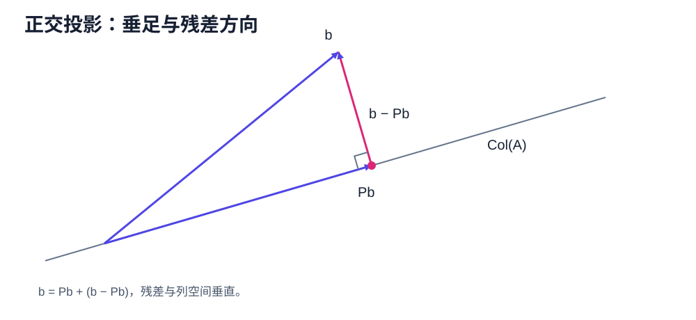
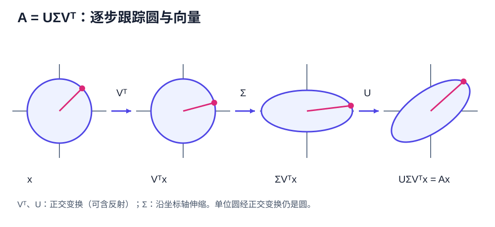

# SVD & Least Squares

本章从正交投影开始，推导最小二乘问题（least-squares problem）与奇异值分解（Singular Value Decomposition，SVD），并完成一个可逐步复算的 SVD 手算例子。摩尔－彭若斯伪逆（Moore–Penrose pseudoinverse）、全部最小二乘解和低秩逼近放在下一章。

## 正交性与投影

<figure markdown="span">
  
  <figcaption>正交投影把 $b$ 分成 $Pb$ 与垂直残差 $b-Pb$；最佳逼近证明就是这两个分量的勾股分解。</figcaption>
</figure>

向量 $u,v\in\mathbb R^m$ 正交，记为 $u\perp v$，当且仅当 $u^Tv=0$。若 $u$ 是单位向量，则 $b$ 在 $u$ 方向的正交投影为

$$
\operatorname{proj}_u(b)=(u^Tb)u.
$$

若 $U\in\mathbb R^{m\times r}$ 的列标准正交，即 $U^TU=I_r$，则

$$
P=UU^T
$$

先手算一次一维投影。令

$$
u=\frac1{\sqrt2}\begin{pmatrix}1\\1\end{pmatrix},
\qquad
b=\begin{pmatrix}3\\1\end{pmatrix}.
$$

投影系数为 $u^Tb=4/\sqrt2=2\sqrt2$，所以

$$
Pb=(u^Tb)u=\begin{pmatrix}2\\2\end{pmatrix},
\qquad
b-Pb=\begin{pmatrix}1\\-1\end{pmatrix}.
$$

直接检查 $u^T(b-Pb)=0$，说明残差确实垂直于投影方向。这个两维计算就是后面矩阵公式 $Pb=UU^Tb$ 的最小原型。

**命题。** $P$ 是到 $\operatorname{Col}(U)$ 的正交投影算子（orthogonal projector）：它满足

$$
P^T=P,
\qquad
P^2=P.
$$

并且对每个 $b$，$Pb\in\operatorname{Col}(U)$，残差 $b-Pb$ 与 $\operatorname{Col}(U)$ 正交。

??? proof "证明"

    由转置运算和 $U^TU=I_r$，

    $$
    P^T=(UU^T)^T=UU^T=P,
    $$

    且

    $$
    P^2=UU^TUU^T=U(U^TU)U^T=UU^T=P.
    $$

    对任意 $b$，$Pb=U(U^Tb)$ 是 $U$ 的列向量的线性组合，所以属于 $\operatorname{Col}(U)$。同时

    $$
    U^T(b-Pb)=U^Tb-U^TUU^Tb=0,
    $$

    所以 $b-Pb$ 与 $U$ 的每一列正交，因而与整个列空间正交。

### 最佳逼近性质

**定理。** $Pb$ 是 $\operatorname{Col}(U)$ 中距离 $b$ 最近的唯一向量。

??? proof "证明"

    任取 $y\in\operatorname{Col}(U)$，有分解

    $$
    b-y=(b-Pb)+(Pb-y).
    $$

    第一项与整个列空间正交，第二项属于列空间，所以两项正交。直接展开内积：

    $$
    \begin{aligned}
    \|b-y\|_2^2
    &=\|(b-Pb)+(Pb-y)\|_2^2\\
    &=\|b-Pb\|_2^2+\|Pb-y\|_2^2
      +2(b-Pb)^T(Pb-y)\\
    &=\|b-Pb\|_2^2+\|Pb-y\|_2^2\\
    &\ge\|b-Pb\|_2^2.
    \end{aligned}
    $$

    等号成立当且仅当 $\|Pb-y\|_2=0$，也就是 $y=Pb$，所以最近向量唯一。

## 最小二乘问题（Least-Squares Problem）

给定 $A\in\mathbb R^{m\times n}$ 与 $b\in\mathbb R^m$，最小二乘问题为

$$
\min_{x\in\mathbb R^n}\|Ax-b\|_2^2.
$$

目标不是让 $x$ 接近 $b$，而是让可达到的向量 $Ax\in\operatorname{Col}(A)$ 接近 $b$。

令 $f(x)=\|Ax-b\|_2^2$，展开得

$$
f(x)=x^TA^TAx-2b^TAx+b^Tb.
$$

对零基础读者，可以先按分量检查导数。写 $A$ 的第 $i$ 行为 $a_i^T$，则

$$
f(x)=\sum_{i=1}^m(a_i^Tx-b_i)^2.
$$

对第 $j$ 个分量 $x_j$ 求偏导，并使用单变量链式法则：

$$
\frac{\partial f}{\partial x_j}
=2\sum_{i=1}^m(a_i^Tx-b_i)a_{ij}.
$$

把 $n$ 个偏导按列排起来，正好得到

$$
\nabla f(x)=2A^T(Ax-b).
$$

驻点满足正规方程（normal equations）：

$$
A^TAx=A^Tb.
$$

### 必要性与充分性

**定理。** 向量 $x_*$ 是最小二乘解，当且仅当它满足正规方程

$$
A^T(Ax_*-b)=0.
$$

此外，最小二乘解唯一，当且仅当 $\ker(A)=\{0\}$。

??? proof "证明"

    先证充分性。若 $A^T(Ax_*-b)=0$，则对任意 $h$，

    $$
    \begin{aligned}
    \|A(x_*+h)-b\|_2^2
    &=\|Ax_*-b+Ah\|_2^2\\
    &=\|Ax_*-b\|_2^2
    +2h^TA^T(Ax_*-b)+\|Ah\|_2^2\\
    &=\|Ax_*-b\|_2^2+\|Ah\|_2^2\\
    &\ge\|Ax_*-b\|_2^2.
    \end{aligned}
    $$

    所以 $x_*$ 是全局最小点。

    再证必要性。若 $x_*$ 是最小点，对任意方向 $h$ 定义单变量函数

    $$
    \phi(t)=\|A(x_*+th)-b\|_2^2.
    $$

    $t=0$ 是 $\phi$ 的最小点，因此 $\phi'(0)=0$。直接求导得到

    $$
    \phi'(0)=2h^TA^T(Ax_*-b)=0.
    $$

    这对所有 $h$ 成立。特别取 $h=A^T(Ax_*-b)$，便有

    $$
    \|A^T(Ax_*-b)\|_2^2=0,
    $$

    所以正规方程成立。

    最后证明唯一性判据。如果存在 $0\ne h\in\ker(A)$，则 $A(x_*+h)=Ax_*$，所以 $x_*+h$ 与 $x_*$ 有同一个目标值，解不唯一。反过来，若 $\ker(A)=\{0\}$，则对 $h\ne0$ 有 $Ah\ne0$，上面的目标差 $\|Ah\|_2^2$ 严格为正，所以没有另一个最小点。

## 奇异值分解（Singular Value Decomposition）

<figure markdown="span">
  
  <figcaption>$V^T$ 先选择正交输入方向，$\Sigma$ 沿坐标轴伸缩，$U$ 再把结果旋转到输出空间。</figcaption>
</figure>

**标准正交基扩充引理。** 欧几里得空间中的任意标准正交向量组，都能扩充为整个空间的一组标准正交基。

??? proof "证明"

    由第一章的基扩充引理，先把已有的标准正交向量 $u_1,\ldots,u_k$ 扩充成一组基 $u_1,\ldots,u_k,w_{k+1},\ldots,w_n$。先令 $q_i=u_i$（$1\le i\le k$），再依次处理 $w_j$：减去它在此前所有单位向量方向上的投影，

    $$
    \widetilde w_j
    =w_j-\sum_{i<j}(q_i^Tw_j)q_i,
    $$

    再令 $q_j=\widetilde w_j/\|\widetilde w_j\|_2$。因为原向量组线性无关，$\widetilde w_j\ne0$；按构造，$q_j$ 与此前各向量正交且长度为一。有限次重复后得到所需标准正交基。这就是格拉姆－施密特过程（Gram–Schmidt process）。

**奇异值分解定理（SVD Theorem）。** 对任意 $A\in\mathbb R^{m\times n}$，存在正交矩阵

$$
U\in\mathbb R^{m\times m},
\qquad
V\in\mathbb R^{n\times n},
$$

以及矩形对角矩阵 $\Sigma\in\mathbb R^{m\times n}$，使

$$
A=U\Sigma V^T.
$$

$\Sigma$ 的非零对角元为

$$
\sigma_1\ge\sigma_2\ge\cdots\ge\sigma_r>0,
\qquad r=\operatorname{rank}(A),
$$

称为奇异值（singular values）。

正特征值的个数等于 $\operatorname{rank}(A)$，需要下面的等式而不是默认。

??? proof "$\operatorname{rank}(A^TA)=\operatorname{rank}(A)$"

    对任意 $x$，$Ax=0$ 显然推出 $A^TAx=0$。反过来，若 $A^TAx=0$，则

    $$0=x^TA^TAx=\|Ax\|_2^2,$$

    所以 $Ax=0$。因此 $\ker(A^TA)=\ker(A)$。两者定义域都是 $\mathbb R^n$，由秩－零化度定理，它们秩相同。对称半正定矩阵 $A^TA$ 的秩等于其非零特征值个数，而非零特征值都为正。

??? proof "证明：从谱定理构造奇异值分解"

    $A^TA$ 是实对称半正定矩阵，因此存在正交矩阵 $V$ 使

    $$
    A^TA=V\Lambda V^T,
    \qquad
    \Lambda=\operatorname{diag}(\lambda_1,\ldots,\lambda_n),
    \quad \lambda_i\ge0.
    $$

    定义 $\sigma_i=\sqrt{\lambda_i}$。对每个 $\sigma_i>0$，令

    $$
    u_i=\frac{Av_i}{\sigma_i}.
    $$

    记 Kronecker delta 为 $\delta_{ij}$：$i=j$ 时为 1，否则为 0。则

    $$
    u_i^Tu_j
    =\frac{v_i^TA^TAv_j}{\sigma_i\sigma_j}
    =\frac{\lambda_jv_i^Tv_j}{\sigma_i\sigma_j}
    =\delta_{ij}.
    $$

    所以这些 $u_i$ 标准正交。再把它们补成 $\mathbb R^m$ 的标准正交基，即得到 $U$。同时

    $$
    Av_i=\sigma_i u_i\qquad(1\le i\le r),
    \qquad
    A^Tu_i=\sigma_i v_i
    $$

    对正奇异值成立，从而 $A=U\Sigma V^T$。

    还需检查零特征值对应的方向。若 $\lambda_i=0$，则

    $$
    \|Av_i\|_2^2
    =v_i^TA^TAv_i
    =\lambda_i\|v_i\|_2^2
    =0,
    $$

    所以 $Av_i=0$。这里必须按矩阵形状读下标：若 $p=\min(m,n)$，则只有 $1\le i\le p$ 时 $u_i$ 与 $\sigma_i$ 同时存在；当宽矩阵满足 $n>m$ 时，额外的 $v_i$（$m<i\le n$）只满足 $Av_i=0$，不能写成不存在的 $u_i$。逐列比较后，前 $p$ 列满足 $Av_i=\sigma_i u_i$，宽矩阵多出的列满足 $Av_i=0$，合起来恰是 $AV=U\Sigma$，即 $A=U\Sigma V^T$。

### 紧致奇异值分解（Compact SVD）

只保留正奇异值对应的向量，得到紧致奇异值分解：

$$
A=U_r\Sigma_rV_r^T,
$$

其中

$$
U_r\in\mathbb R^{m\times r},
\quad
\Sigma_r\in\mathbb R^{r\times r},
\quad
V_r\in\mathbb R^{n\times r}.
$$

这里 $\operatorname{Col}(A)=\operatorname{Col}(U_r)$，而 $\ker(A)=\operatorname{Col}(V_0)$，其中 $V=[V_r\ V_0]$。

## 奇异值分解的手工计算

取

$$
A=\begin{pmatrix}1&1\\1&-1\\0&0\end{pmatrix}.
$$

第一步计算

$$
A^TA
=\begin{pmatrix}2&0\\0&2\end{pmatrix}.
$$

特征值均为 $2$，故奇异值 $\sigma_1=\sigma_2=\sqrt2$。可取

$$
v_1=\begin{pmatrix}1\\0\end{pmatrix},
\qquad
v_2=\begin{pmatrix}0\\1\end{pmatrix}.
$$

然后

$$
u_1=\frac{Av_1}{\sqrt2}
=\frac1{\sqrt2}\begin{pmatrix}1\\1\\0\end{pmatrix},
\qquad
u_2=\frac{Av_2}{\sqrt2}
=\frac1{\sqrt2}\begin{pmatrix}1\\-1\\0\end{pmatrix}.
$$

补上 $u_3=(0,0,1)^T$，得到

$$
U=\begin{pmatrix}
1/\sqrt2&1/\sqrt2&0\\
1/\sqrt2&-1/\sqrt2&0\\
0&0&1
\end{pmatrix},
\quad
\Sigma=\begin{pmatrix}
\sqrt2&0\\0&\sqrt2\\0&0
\end{pmatrix},
\quad V=I_2.
$$

直接相乘可验证 $U\Sigma V^T=A$。
## 练习

1. 证明 $P=UU^T$ 对称且幂等，并证明 $I-P$ 也是正交投影。
2. 对 $A=\operatorname{diag}(3,2,0)$ 写出完整奇异值分解（full SVD）与紧致奇异值分解。

??? tip "第一步提示"

    第 1 题先分别计算 $P^T$ 与 $P^2$；第 2 题先计算 $A^TA$，再按奇异值从大到小排列对应向量。

**答案。** 第 1 题使用 $U^TU=I$；第 2 题可取 $U=V=I$、$\Sigma=\operatorname{diag}(3,2,0)$。

**上一章：** [矩阵范数与谱理论](01-matrix-norms-spectral.md)  
**下一章：** [伪逆与低秩逼近](02-pseudoinverse-low-rank.md)
