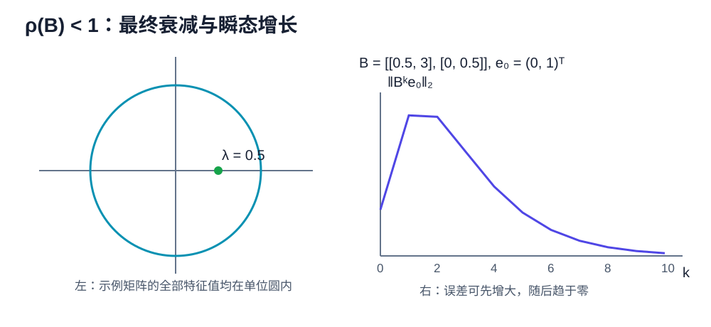

# Linear Iterations & Power Method

线性迭代的核心不是“多算几步”，而是从更新式提取误差传播矩阵（error propagation matrix），并判断它的幂是否趋于零。本章给出完整充要条件，然后推导雅可比方法（Jacobi）、高斯－赛德尔方法（Gauss–Seidel）、理查森迭代（Richardson）与幂法（power method）。

## 标量线性迭代

先考虑

$$
x_{k+1}=ax_k+c.
$$

若 $a\ne1$，固定点为 $x^*=c/(1-a)$。令 $e_k=x_k-x^*$，则

$$
e_{k+1}=ae_k,
\qquad
e_k=a^ke_0.
$$

**命题。** 标量迭代对任意初值收敛到固定点，当且仅当 $|a|<1$。

??? proof "证明"

    若 $|a|<1$，则 $a^k\to0$，所以 $e_k=a^ke_0\to0$。反过来，若迭代对任意初值收敛，取 $e_0\ne0$，便必须有 $a^ke_0\to0$，即 $a^k\to0$，这要求 $|a|<1$。

    当 $a<0$ 时误差交替变号，但只要 $|a|<1$，其绝对值仍趋于零。

## 定常矩阵迭代

考虑

$$
x_{k+1}=Bx_k+c,
\qquad B\in\mathbb C^{n\times n}.
$$

若存在固定点 $x^*$，则 $(I-B)x^*=c$。相减得到

$$
e_{k+1}=Be_k,
\qquad
e_k=B^ke_0.
$$

所以“对任意初值收敛到同一个固定点”等价于 $B^k\to0$。

## 谱半径收敛判据

<figure markdown="span">
  
  <figcaption>谱半径控制渐近行为；“最终趋于零”不等于“每一步在二范数下都缩小”。</figcaption>
</figure>

**定理。** 对方阵 $B$，以下命题等价：

1. $B^k\to0$；
2. $\rho(B)<1$；
3. 对每个初值，$x_{k+1}=Bx_k+c$ 收敛到唯一固定点 $(I-B)^{-1}c$。

??? proof "证明"

    若 $B^k\to0$，任取特征对 $Bv=\lambda v$，$v\ne0$，则

    $$
    B^kv=\lambda^kv\to0.
    $$

    因此 $|\lambda|<1$。对所有特征值成立，所以 $\rho(B)<1$。

    ### 可对角化矩阵情形的充分性

    若 $B=V\Lambda V^{-1}$，则

    $$
    B^k=V\Lambda^kV^{-1}.
    $$

    $\rho(B)<1$ 意味着每个 $|\lambda_i|<1$，故 $\Lambda^k\to0$，从而 $B^k\to0$。

    ### 一般矩阵情形的充分性

    不需要假设 $B$ 可对角化。先证明任意复矩阵都相似于上三角矩阵。由第零章已经证明的代数基本定理，特征多项式至少有一个复根 $\lambda_1$，从而存在特征向量 $v_1$。由第一章的基扩充引理，把 $v_1$ 扩充成一组基；在这组基下矩阵具有分块形式

    $$
    \begin{pmatrix}
    \lambda_1&*\\
    0&C
    \end{pmatrix}.
    $$

    对 $(n-1)\times(n-1)$ 矩阵 $C$ 重复这个过程，按维数归纳便得到 $B=PTP^{-1}$，其中 $T$ 上三角，且对角元就是 $B$ 的特征值。

    下面证明当 $T$ 的对角元模都小于 $1$ 时 $T^k\to0$。取满足

    $$
    \rho(B)<r<1
    $$

    的数 $r$，并写 $T=D+N$，其中 $D$ 是对角部分，$N$ 是严格上三角部分。展开 $(D+N)^k$ 时不能交换 $D,N$，但可保留原有次序逐个列出所有长度为 $k$ 的乘积词。含有至少 $n$ 个 $N$ 的词为零，因为每乘一次严格上三角矩阵，非零元素至少向右移动一列。含有 $j\le n-1$ 个 $N$ 的词至多有 $\binom{k}{j}$ 个；其余 $k-j$ 个因子来自 $D$，模至多为 $r^{k-j}$。把有限个 $N$ 元素和基变换常数吸收到 $C$ 中，并用 $\binom{k}{j}\le k^j$，得到

    $$
    |(T^k)_{ij}|\le Ck^{n-1}r^{k-n+1}.
    $$

    指数衰减压过任何固定次数的多项式；例如相邻项比值趋于 $r<1$，所以右侧趋于零。故 $T^k\to0$，进而

    $$
    B^k=PT^kP^{-1}\to0.
    $$

    ### 不动点的存在性与唯一性

    $\rho(B)<1$ 时，$1$ 不是 $B$ 的特征值，故 $I-B$ 可逆，固定点唯一。还可使用 Neumann series：

    $$
    (I-B)^{-1}=\sum_{j=0}^{\infty}B^j.
    $$

    因为部分和满足

    $$
    (I-B)\sum_{j=0}^{N}B^j=I-B^{N+1}\to I.
    $$

    因而对任意初值，

    $$
    x_k-x^*=B^k(x_0-x^*)\to0,
    $$

    所以命题 2 推出命题 3。最后，若命题 3 成立，任取两个初值 $x_0,y_0$，对应迭代之差满足

    $$
    x_k-y_k=B^k(x_0-y_0)\to0.
    $$

    令 $x_0-y_0$ 依次取标准基向量，就得到 $B^k$ 的每一列都趋于零，即 $B^k\to0$。所以命题 3 推出命题 1，三个命题确实等价。

## 矩阵分裂

线性系统 $Ax=b$ 可通过 splitting

$$
A=M-N
$$

改写为

$$
Mx_{k+1}=Nx_k+b,
$$

即

$$
x_{k+1}=M^{-1}Nx_k+M^{-1}b.
$$

迭代矩阵是 $B=M^{-1}N$，对任意初值收敛当且仅当

$$
\rho(M^{-1}N)<1.
$$

分析时不需要先知道精确解，只需识别迭代矩阵。

## 雅可比方法（Jacobi Method）

写

$$
A=D+L+U,
$$

其中 $D$ 是对角部分，$L,U$ 分别是严格下三角和上三角部分。雅可比方法为

$$
Dx_{k+1}=b-(L+U)x_k,
$$

故

$$
B_J=-D^{-1}(L+U)=I-D^{-1}A.
$$

**例子。** 对

$$
A=\begin{pmatrix}4&1\\1&3\end{pmatrix},
$$

有

$$
B_J=\begin{pmatrix}0&-1/4\\-1/3&0\end{pmatrix}.
$$

特征值为 $\pm1/\sqrt{12}$，所以 $\rho(B_J)<1$，雅可比迭代对任意初值收敛。

## 高斯－赛德尔方法（Gauss–Seidel Method）

高斯－赛德尔方法使用当前轮已经更新的分量：

$$
(D+L)x_{k+1}=b-Ux_k,
$$

所以

$$
B_{GS}=-(D+L)^{-1}U.
$$

对二维系统

$$
\begin{cases}
4x+y=1,\\
x+3y=2,
\end{cases}
$$

雅可比方法同时使用旧值：

$$
x_{k+1}=\frac{1-y_k}{4},
\qquad
y_{k+1}=\frac{2-x_k}{3}.
$$

高斯－赛德尔方法的第二式使用刚得到的 $x_{k+1}$：

$$
x_{k+1}=\frac{1-y_k}{4},
\qquad
y_{k+1}=\frac{2-x_{k+1}}{3}.
$$

二者不能仅凭名称比较速度，应比较各自迭代矩阵的谱半径。

## 理查森迭代（Richardson Iteration）

理查森迭代为

$$
x_{k+1}=x_k+\omega(b-Ax_k),
$$

其迭代矩阵为

$$
B_\omega=I-\omega A.
$$

若 $A$ 是对称正定矩阵（symmetric positive definite matrix），特征值满足

$$
0<\lambda_{\min}\le\lambda_i\le\lambda_{\max},
$$

**命题。** 理查森迭代对任意初值收敛，当且仅当 $0<\omega<2/\lambda_{\max}$。在这个区间中，最优固定步长和相应谱半径为

$$
\omega_*=\frac{2}{\lambda_{\min}+\lambda_{\max}},
\qquad
q_*=\frac{\kappa_2(A)-1}{\kappa_2(A)+1}.
$$

??? proof "证明"

    由谱半径收敛判据，收敛条件为

    $$
    |1-\omega\lambda_i|<1
    \quad\text{for all }i,
    $$

    等价于

    $$
    0<\omega<\frac{2}{\lambda_{\max}}.
    $$

    函数 $|1-\omega\lambda|$ 关于 $\lambda$ 是凸函数，所以它在 $[\lambda_{\min},\lambda_{\max}]$ 上的最大值必在端点取得。要使两个端点绝对值的最大者最小，最优点必须让它们大小相等且符号相反；否则向降低较大者的方向小幅移动 $\omega$，还能继续减小最大值。因此

    $$
    1-\omega\lambda_{\min}
    =-(1-\omega\lambda_{\max}),
    $$

    所以

    $$
    \omega_*=\frac{2}{\lambda_{\min}+\lambda_{\max}},
    $$

    对应收敛因子

    $$
    q_*=\frac{\kappa_2(A)-1}{\kappa_2(A)+1}.
    $$

条件数越大，$q_*$ 越接近 $1$，迭代越慢。

## 范数界与瞬态增长

若某个诱导范数下 $\|B\|=q<1$，则

$$
\|e_k\|\le q^k\|e_0\|.
$$

这是简单的非渐近误差界。但 $\rho(B)<1$ 不保证预先指定的 $\|B\|_2<1$。非正规矩阵可能先放大误差再最终衰减，例如

$$
B=\begin{pmatrix}0&10\\0&0\end{pmatrix}.
$$

$B^2=0$，所以两步后误差归零；但某些向量第一步会被放大十倍。

## 幂零迭代

若 $\rho(B)=0$，则所有特征值为零，特征多项式为 $p_B(t)=t^n$。凯莱－哈密顿定理（Cayley–Hamilton theorem）说明 $p_B(B)=0$，故

$$
B^n=0.
$$

??? proof "凯莱－哈密顿定理的证明"

    对一般 $n\times n$ 矩阵 $B$，写特征多项式

    $$
    p_B(t)=\det(tI-B)=c_0+c_1t+\cdots+c_nt^n,
    \qquad c_n=1.
    $$

    伴随矩阵恒等式给出

    $$
    (tI-B)\operatorname{adj}(tI-B)=p_B(t)I.
    $$

    这个恒等式直接来自余子式展开：左侧第 $i,i$ 个元素是沿第 $i$ 行展开的行列式 $\det(tI-B)$；第 $i,j$ 个非对角元素相当于把两行取成相同的行再展开，因而为零。

    把伴随矩阵按 $t$ 的次数展开为

    $$
    \operatorname{adj}(tI-B)=C_0+C_1t+\cdots+C_{n-1}t^{n-1}.
    $$

    比较等式两边各次幂的系数，得到

    $$
    -BC_0=c_0I,
    $$

    $$
    C_{j-1}-BC_j=c_jI
    \quad(1\le j\le n-1),
    $$

    以及 $C_{n-1}=c_nI$。将第 $j$ 个系数等式左乘 $B^j$ 后全部相加，中间的 $B^jC_{j-1}$ 项逐项抵消，得到

    $$
    c_0I+c_1B+\cdots+c_nB^n=0.
    $$

    这正是 $p_B(B)=0$。在当前情形 $p_B(t)=t^n$，所以立即得到 $B^n=0$。

所以误差至多经过 $n$ 步精确归零。注意 $\rho(B)=0$ 不意味着 $B=0$，只意味着 $B$ 是 nilpotent。

## 幂法（Power Method）

幂法用于求模最大的特征值及其特征向量。

**定理。** 设 $A$ 可对角化，有特征向量基 $v_1,\ldots,v_n$，并且

$$
|\lambda_1|>|\lambda_2|\ge\cdots\ge|\lambda_n|.
$$

若初值

$$
x_0=\sum_{i=1}^nc_iv_i,
\qquad c_1\ne0,
$$

则 $A^kx_0$ 归一化后的方向趋向 $v_1$ 所张成的一维子空间，方向误差为 $O(|\lambda_2/\lambda_1|^k)$。

??? proof "证明"

    按特征向量基展开，并使用 $A^kv_i=\lambda_i^kv_i$，得到

    $$
    A^kx_0
    =\lambda_1^k
    \left(
    c_1v_1+
    \sum_{i=2}^nc_i
    \left(\frac{\lambda_i}{\lambda_1}\right)^k v_i
    \right).
    $$

    括号内余项的范数至多为某个常数乘 $|\lambda_2/\lambda_1|^k$，所以它趋于 $c_1v_1\ne0$。归一化映射在非零向量附近连续，因此归一化后的方向趋向 $v_1$ 所张成的一维子空间，并具有所述误差阶。

    这里“方向趋向”允许相差一个符号：若主特征值 $\lambda_1<0$，归一化向量可能在 $v_1$ 与 $-v_1$ 之间交替，但它所张成的一维特征子空间仍然收敛。

实际算法为

$$
y_{k+1}=Ax_k,
\qquad
x_{k+1}=\frac{y_{k+1}}{\|y_{k+1}\|_2}.
$$

瑞利商（Rayleigh quotient）

$$
\mu_k=\frac{x_k^TAx_k}{x_k^Tx_k}
$$

可用于估计特征值，特别是 $A$ 对称时。

### 失效条件

幂法可能失败或不能给出唯一方向：

- $c_1=0$，初值没有主特征向量分量；
- 最大模特征值不唯一；
- 最大模特征值形成复共轭对，实迭代可能旋转；
- 谱隙很小，$|\lambda_2/\lambda_1|$ 接近 $1$，收敛很慢。

## 反幂法与位移

首先必须要求位移 $\mu$ 不是 $A$ 的特征值，即 $\mu\notin\sigma(A)$；否则 $A-\mu I$ 不可逆，反幂法这一步没有定义。若 $A$ 可逆，则 $A^{-1}$ 的特征值为 $1/\lambda_i$。在满足上一节幂法假设、且离位移最近的特征值唯一时，对 $(A-\mu I)^{-1}$ 使用幂法会突出最接近位移（shift）$\mu$ 的特征值，因为

$$
(A-\mu I)^{-1}v_i
=\frac1{\lambda_i-\mu}v_i.
$$

数值实现每步求解

$$
(A-\mu I)y_{k+1}=x_k
$$

而不是显式计算逆矩阵。

## 完整示例

设

$$
A=\begin{pmatrix}5&0\\0&2\end{pmatrix},
\qquad x_0=\begin{pmatrix}1\\1\end{pmatrix}.
$$

则

$$
A^kx_0
=\begin{pmatrix}5^k\\2^k\end{pmatrix}
=5^k\begin{pmatrix}1\\(2/5)^k\end{pmatrix}.
$$

第二坐标相对第一坐标的比例是 $(2/5)^k$。要使比例不超过 $10^{-3}$，需要

$$
k\ge\frac{\log(10^{-3})}{\log(2/5)}\approx7.54,
$$

因此 $k=8$ 足够。

## 练习

1. 对 $B=\operatorname{diag}(0.8,-0.6)$ 证明任意初值收敛，并给出误差界。
2. 对 $B=\begin{pmatrix}0&1\\0&0\end{pmatrix}$ 计算 $B^k$，说明误差几步归零。
3. 对 $A=\operatorname{diag}(6,1)$、$x_0=(1,1)^T$，给出幂法的方向误差。
4. 推导 $2\times2$ 对称正定矩阵的最优理查森参数。
5. 说明“某一个特殊初值收敛”为什么不能推出 $\rho(B)<1$。

??? tip "第一步提示"

    第 1、2 题先写 $e_k=B^ke_0$。第 3 题直接计算 $A^kx_0$，再比较非主特征向量分量与主分量的比例。第 4 题令端点处的两个误差放大因子等模，即 $|1-\omega\lambda_{\min}|=|1-\omega\lambda_{\max}|$。第 5 题让初值恰好落在稳定特征子空间。

??? tip "关键转化"

    第 3 题中 $(6^k,1)^T=6^k(1,6^{-k})^T$，括号内第二分量就是相对方向误差。第 4 题对称正定矩阵可在标准正交特征向量基中分析，每个误差分量都乘 $1-\omega\lambda_i$。

??? proof "完整解答"

    1. 写 $e_0=(a,b)^T$，则

       $$
       e_k=(0.8^ka,(-0.6)^kb)^T,
       \qquad
       \|e_k\|_2\le0.8^k\|e_0\|_2\to0.
       $$

       因此任意初始误差都收敛。

    2. 直接相乘得 $B^2=0$，所以 $e_2=B^2e_0=0$；误差至多两步归零。

    3. $A^kx_0=(6^k,1)^T=6^k(1,6^{-k})^T$。相对于主特征向量 $(1,0)^T$，非主分量与主分量之比为 $6^{-k}$，故方向误差为 $O(6^{-k})$。

    4. 设特征值为 $0<\lambda_{\min}\le\lambda_{\max}$。理查森误差矩阵为 $I-\omega A$，其谱半径是区间端点上

       $$
       \max\{|1-\omega\lambda_{\min}|,
       |1-\omega\lambda_{\max}|\}.
       $$

       最优时两个端点等模且符号相反：

       $$
       1-\omega\lambda_{\min}
       =-(1-\omega\lambda_{\max}).
       $$

       因而

       $$
       \omega_*=\frac{2}{\lambda_{\min}+\lambda_{\max}},
       \qquad
       \rho_*=\frac{\lambda_{\max}-\lambda_{\min}}
       {\lambda_{\max}+\lambda_{\min}}.
       $$

    5. 取 $B=\operatorname{diag}(2,1/2)$ 与 $e_0=(0,1)^T$，则 $e_k=(0,2^{-k})^T\to0$，但 $\rho(B)=2>1$。一个特殊初值没有激发不稳定特征方向，因此不能代表所有初值。

**上一章：** [伪逆与低秩逼近](02-pseudoinverse-low-rank.md)  
**下一章：** [不动点与压缩映射](04-fixed-points-contractions.md)

