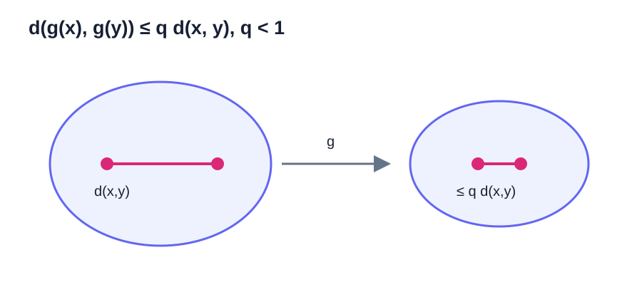

# Fixed Points & Contractions

不动点迭代（fixed-point iteration）把方程求解写成反复应用一个映射。本章严格区分不动点的存在性、唯一性和算法收敛性，并完整证明巴拿赫不动点定理（Banach fixed-point theorem）。

## 不动点与皮卡迭代（Picard Iteration）

若映射 $g:X\to X$ 满足

$$
g(x^*)=x^*,
$$

则 $x^*$ 称为不动点（fixed point）。皮卡迭代为

$$
x_{k+1}=g(x_k).
$$

方程 $f(x)=0$ 可通过 $g(x)=x-\eta f(x)$ 改写为不动点方程（fixed-point equation），但不同 $\eta$ 会产生不同的收敛行为。

存在性、唯一性和迭代收敛性是三个不同命题。$g(x)=x^2$ 有两个不动点 $0,1$；从 $x_0=1/2$ 出发趋于 $0$，从 $x_0=3/2$ 出发发散。

## 度量空间与完备性

度量（metric）$d:X\times X\to[0,\infty)$ 满足：

1. $d(x,y)=0\iff x=y$；
2. $d(x,y)=d(y,x)$；
3. $d(x,z)\le d(x,y)+d(y,z)$。

在 $\mathbb R^n$ 中，$d(x,y)=\|x-y\|_2$ 是常用距离。

在一般度量空间中，$x_k\to x$ 的含义是：对每个 $\varepsilon>0$，存在 $N$，使 $k\ge N$ 时 $d(x_k,x)<\varepsilon$。数列是柯西数列，表示：对每个 $\varepsilon>0$，存在 $N$，使 $m,n\ge N$ 时 $d(x_m,x_n)<\varepsilon$。

度量空间（metric space）$(X,d)$ 称为完备的（complete），如果每个柯西数列都收敛到 $X$ 中的点。开区间 $(0,1)$ 不完备，因为

$$
x_k=\frac1{k+1},\qquad k\ge1,
$$

的每一项都属于 $(0,1)$，它是柯西数列，但极限 $0$ 不在该区间。

**命题。** 欧几里得空间 $\mathbb R^n$ 完备；完备度量空间的每个闭子集在继承距离下仍然完备。

这里采用闭集的序列定义：$F\subset X$ 是闭集，当且仅当 $F$ 中每个收敛数列的极限仍属于 $F$。在度量空间中，这与“补集是开集”的定义等价。

??? proof "闭集两种定义等价"

    若 $F^c$ 开而 $x_k\in F$ 收敛到 $x\notin F$，则存在 $r>0$ 使开球 $B(x,r)\subset F^c$。收敛性却保证充分大的 $k$ 有 $x_k\in B(x,r)$，矛盾。

    反过来，若 $F$ 包含其中收敛数列的极限，而 $F^c$ 不是开集，则存在 $x\in F^c$，使每个 $B(x,1/k)$ 都含有某个 $x_k\in F$。这样 $x_k\to x$，却有 $x\notin F$，同样矛盾。

??? proof "证明"

    若 $(x_k)$ 是 $\mathbb R^n$ 中的柯西数列，则每个坐标列都是实数柯西数列。由第零章采用的实数完备性，每个坐标都收敛。把各坐标极限组成 $x\in\mathbb R^n$，有限个坐标误差同时趋于零，故 $\|x_k-x\|_2\to0$。所以 $\mathbb R^n$ 完备。

    再设 $F$ 是完备空间 $X$ 的闭子集，$(x_k)$ 是 $F$ 中的柯西数列。它也是 $X$ 中的柯西数列，因此收敛到某个 $x\in X$。闭集包含其中所有收敛序列的极限，故 $x\in F$。所以 $F$ 完备。

## 自映射与压缩映射

<figure markdown="span">
  
  <figcaption markdown="span">压缩性比较的是任意两点经过映射前后的距离，而不只是某个点附近的一次导数。</figcaption>
</figure>

$g:X\to X$ 是自映射（self-map），表示迭代不会离开 $X$。若存在 $q\in[0,1)$ 使对所有 $x,y\in X$，

$$
d(g(x),g(y))\le q\,d(x,y),
$$

则 $g$ 是压缩映射（contraction mapping），$q$ 是压缩因子（contraction factor）。

**命题。** 在实区间 $I$ 上，若 $g$ 可微且

$$
\sup_{x\in I}|g'(x)|\le q<1,
$$

则 $|g(x)-g(y)|\le q|x-y|$ 对所有 $x,y\in I$ 成立。

??? proof "证明"

    对 $x\ne y$，中值定理给出位于两点之间的 $\xi$，使

    $$
    g(x)-g(y)=g'(\xi)(x-y).
    $$

    取绝对值得所需不等式；$x=y$ 时结论显然成立。

仅有导数界还不够，必须同时验证 $g(I)\subseteq I$，才能把迭代限制在同一个完备集合中。

## 巴拿赫不动点定理（Banach Fixed-Point Theorem）

**定理。** 设 $(X,d)$ 是非空完备度量空间，$g:X\to X$ 是压缩映射，压缩因子为 $q<1$。则：

1. $g$ 在 $X$ 中存在唯一不动点 $x^*$；
2. 对任意 $x_0\in X$，皮卡迭代 $x_{k+1}=g(x_k)$ 收敛到 $x^*$；
3. 具有可计算的先验与后验误差界。

??? proof "证明"

    **第一步：控制相邻迭代点之差。** 由压缩性反复使用同一不等式，

    $$
    d(x_{k+1},x_k)
    \le q\,d(x_k,x_{k-1})
    \le\cdots\le q^k d(x_1,x_0).
    $$

    **第二步：证明迭代列是柯西数列。** 对 $m>n$，由三角不等式，

    $$
    \begin{aligned}
    d(x_m,x_n)
    &\le\sum_{j=n}^{m-1}d(x_{j+1},x_j)\\
    &\le\sum_{j=n}^{m-1}q^j d(x_1,x_0)\\
    &\le\frac{q^n}{1-q}d(x_1,x_0).
    \end{aligned}
    $$

    右侧随 $n\to\infty$ 趋于零，因此对任意 $\varepsilon>0$，当 $m>n$ 足够大时都有 $d(x_m,x_n)<\varepsilon$。

    **第三步：证明存在性。** $X$ 完备，所以存在 $x^*\in X$ 使 $x_n\to x^*$。压缩映射自动连续，因为

    $$
    d(g(x),g(y))\le qd(x,y).
    $$

    因而

    $$
    x^*=\lim_{n\to\infty}x_{n+1}
    =\lim_{n\to\infty}g(x_n)
    =g(x^*).
    $$

    **第四步：证明唯一性。** 若 $x^*,y^*$ 都是不动点，则

    $$
    d(x^*,y^*)
    =d(g(x^*),g(y^*))
    \le qd(x^*,y^*).
    $$

    移项得到 $(1-q)d(x^*,y^*)\le0$。由于 $1-q>0$ 且距离非负，只能有 $d(x^*,y^*)=0$，即 $x^*=y^*$。

## 误差上界

**推论。** 在巴拿赫不动点定理的条件下，先验误差界（a priori bound）与后验误差界（a posteriori bound）分别为

$$
d(x_n,x^*)
\le\frac{q^n}{1-q}d(x_1,x_0)
,
\qquad
d(x_n,x^*)
\le\frac{q}{1-q}d(x_n,x_{n-1})
$$

??? proof "证明"

    巴拿赫定理的证明已经得到：对 $m>n$，

    $$
    d(x_m,x_n)
    \le \frac{q^n(1-q^{m-n})}{1-q}d(x_1,x_0).
    $$

    由三角不等式可得

    $$
    |d(x_m,x_n)-d(x^*,x_n)|\le d(x_m,x^*)\to0.
    $$

    上式是度量版反三角不等式；它由三角不等式分别写成 $d(x_m,x_n)\le d(x_m,x^*)+d(x^*,x_n)$ 和交换 $x_m,x^*$ 后合并得到。因而令 $m\to\infty$，便得

    $$
    d(x_n,x^*)\le\frac{q^n}{1-q}d(x_1,x_0).
    $$

    把同一估计的起点改为 $x_{n-1}$，则

    $$
    d(x_n,x^*)
    \le\frac{q}{1-q}d(x_n,x_{n-1}).
    $$

第一式适合预估迭代次数，第二式适合根据已经观察到的相邻差决定停止。

若要求先验误差界不超过 $\varepsilon$，需要

$$
\frac{q^n}{1-q}d(x_1,x_0)\le\varepsilon.
$$

当 $0<q<1$ 时，$\log q<0$，故

$$
n\ge
\frac{\log\left(\varepsilon(1-q)/d(x_1,x_0)\right)}{\log q}.
$$

最后向上取整。$q=0$ 时 $g$ 是常值映射，一步到达不动点，应单独处理。

## 一维完整示例

设

$$
g(x)=\frac12\cos x,
\qquad I=[-1,1].
$$

**自映射（Self-map）。** 对 $x\in I$，$|g(x)|\le1/2$，所以 $g(I)\subseteq I$。

**压缩性（Contraction）。** $g'(x)=-(1/2)\sin x$，所以 $|g'(x)|\le1/2$。可取 $q=1/2$。

**完备性（Completeness）。** $I$ 是 $\mathbb R$ 的非空闭子集，因此完备。

巴拿赫定理保证 $I$ 中存在唯一不动点，且从任意 $x_0\in I$ 出发收敛。若 $x_0=0$，则 $x_1=1/2$，先验误差界为

$$
|x_n-x^*|
\le\frac{(1/2)^n}{1-1/2}\cdot\frac12
=2^{-n}.
$$

要保证误差严格小于 $10^{-8}$，取 $n=27$ 即可，因为 $2^{-27}<10^{-8}$。

## 不满足压缩条件时的存在性

**定理。** 若 $g:[a,b]\to[a,b]$ 连续，则至少存在一个不动点。

??? proof "证明"

    定义

    $$
    h(x)=g(x)-x.
    $$

    由于 $g$ 把 $[a,b]$ 映入自身，$g(a)\ge a$ 且 $g(b)\le b$，所以 $h(a)\ge0$、$h(b)\le0$。函数 $h$ 连续，由介值定理，存在 $c\in[a,b]$ 使 $h(c)=0$，即 $g(c)=c$。

这个结论只保证存在，不保证唯一，也不保证皮卡迭代收敛。例如 $g(x)=1-x$ 将 $[0,1]$ 映回自身且连续，唯一不动点为 $1/2$；但除非 $x_0=1/2$，迭代会在 $x_0$ 与 $1-x_0$ 之间振荡。

## 不动点迭代的局部收敛性

**定理。** 设 $g(x^*)=x^*$、$g'$ 在 $x^*$ 附近连续且 $|g'(x^*)|<1$，则 $x^*$ 是局部吸引不动点。

??? proof "证明"

    可取 $q$ 满足

    $$
    |g'(x^*)|<q<1.
    $$

    由连续性，存在半径 $r>0$，使 $|x-x^*|\le r$ 时 $|g'(x)|\le q$。由中值定理，

    $$
    |g(x)-x^*|
    =|g(x)-g(x^*)|
    \le q|x-x^*|
    \le qr<r.
    $$

    因此闭区间 $[x^*-r,x^*+r]$ 是不变集（invariant set），且 $g$ 在该区间上是压缩映射。巴拿赫定理给出从该区间内任意初值出发的收敛性。

若 $|g'(x^*)|>1$，不动点通常是排斥的（repelling）。若 $|g'(x^*)|=1$，一阶判据没有结论，必须检查更高阶项。

## 向量压缩映射

**定理。** 设 $D\subset\mathbb R^n$ 非空、闭且凸，$g$ 定义在包含 $D$ 的开集上并连续可微，且 $g(D)\subset D$。若欧几里得诱导范数下

$$
\sup_{x\in D}\|J_g(x)\|_2\le q<1,
$$

则 $g$ 是压缩映射。

??? proof "证明"

    任取 $x,y\in D$。若 $g(x)=g(y)$，结论显然成立。以下设 $g(x)\ne g(y)$，并令

    $$
    u=\frac{g(x)-g(y)}{\|g(x)-g(y)\|_2}.
    $$

    凸性保证线段 $y+t(x-y)$ 留在 $D$。定义单变量实函数

    $$
    \phi(t)=u^Tg\bigl(y+t(x-y)\bigr),
    \qquad 0\le t\le1.
    $$

    由链式法则，

    $$
    \phi'(t)=u^TJ_g\bigl(y+t(x-y)\bigr)(x-y).
    $$

    对 $\phi$ 使用第零章的单变量中值定理，存在 $\xi\in(0,1)$ 使

    $$
    \begin{aligned}
    \|g(x)-g(y)\|_2
    &=u^T(g(x)-g(y))\\
    &=\phi(1)-\phi(0)\\
    &=\phi'(\xi)\\
    &\le \|u\|_2\,
    \|J_g(y+\xi(x-y))\|_2\,
    \|x-y\|_2\\
    &\le q\|x-y\|_2.
    \end{aligned}
    $$

    这里使用了柯西－施瓦茨不等式、$\|u\|_2=1$ 和诱导范数的相容性。因此 $g$ 是压缩映射。

只知道 $\rho(J_g(x^*))<1$ 是局部线性化信息，不能直接推出整个区域上的一致压缩性。

## 二维完整示例

在闭方形 $D=[0,1]^2$ 上定义

$$
g(x,y)
=\left(\frac{x+y}{4},\frac{x-y}{4}+\frac12\right).
$$

先验证自映射条件。对 $(x,y)\in D$，

$$
0\le \frac{x+y}{4}\le\frac12,
\qquad
\frac14\le\frac{x-y}{4}+\frac12\le\frac34,
$$

故 $g(D)\subset D$。它的雅可比矩阵（Jacobian）是常矩阵

$$
J_g=
\begin{pmatrix}
1/4&1/4\\
1/4&-1/4
\end{pmatrix},
\qquad
J_g^TJ_g=\frac18I.
$$

因此欧几里得算子范数（Euclidean operator norm）为

$$
\|J_g\|_2=\sqrt{\lambda_{\max}(J_g^TJ_g)}
=\frac1{2\sqrt2}=:q<1.
$$

$D$ 是 $\mathbb R^2$ 的闭子集，所以在欧几里得度量（Euclidean metric）下完备。巴拿赫定理因而保证 $g$ 在 $D$ 内有唯一不动点，且从 $D$ 内任意初值出发的皮卡迭代都收敛。

固定点方程等价于

$$
3x-y=0,
\qquad
5y-x=2.
$$

解得

$$
(x^*,y^*)=\left(\frac17,\frac37\right).
$$

若取 $z_0=(0,0)^T$，则 $z_1=(0,1/2)^T$，所以 $\|z_1-z_0\|_2=1/2$。先验误差界为

$$
\|z_n-z^*\|_2
\le \frac{q^n}{1-q}\,\frac12.
$$

要保证该上界不超过 $\varepsilon$，只需

$$
n\ge
\frac{\log\!\bigl(2\varepsilon(1-q)\bigr)}{\log q}.
$$

取 $\varepsilon=10^{-4}$ 与 $q=1/(2\sqrt2)$，右端约为 $8.61$，故 $n=9$ 次迭代足够。这一例子完整展示了二维情形中的自映射、雅可比矩阵范数（Jacobian norm）、存在唯一性、误差上界和迭代次数。

## 不动点迭代格式的设计

同一方程可以产生不同迭代。对 $f(x)=x^2-2=0$，取

$$
g_\eta(x)=x-\eta(x^2-2).
$$

在正根 $\alpha=\sqrt2$，

$$
g_\eta'(\alpha)=1-2\eta\sqrt2.
$$

由本章已证明的局部收敛定理，下面的不等式是一个便于验证的**充分条件**：

$$
|1-2\eta\sqrt2|<1,
$$

即 $0<\eta<1/\sqrt2$。它不是必要条件：当 $|g'(x^*)|=1$ 时一阶判据没有结论，例如 $g(x)=x-x^3$ 在 $x^*=0$ 满足 $g'(0)=1$，但足够接近零的非零初值仍收敛到零。当 $\eta=1/(2\sqrt2)$ 时导数为零，线性误差项消失，局部速度可能提高。算法设计的核心正是调整误差映射，而不只是保持相同不动点。

## 精确误差与定理上界

考虑

$$
g(x)=\frac{x+1}{4},
\qquad x_0=0.
$$

固定点为 $x^*=1/3$，且

$$
e_{n+1}=\frac14e_n,
\qquad
|e_n|=\frac13\,4^{-n}.
$$

要使 $|e_n|<10^{-5}$，需 $4^n>1/(3\times10^{-5})$，所以 $n=8$ 足够。

巴拿赫先验界使用 $q=1/4$、$|x_1-x_0|=1/4$：

$$
|e_n|
\le\frac{(1/4)^n}{1-1/4}\cdot\frac14
=\frac13\,4^{-n}.
$$

在这个线性例子中，通用界恰好等于精确误差。

## 练习

1. 证明 $g(x)=x/4+3$ 在 $\mathbb R$ 上是压缩映射，并求唯一不动点。
2. 说明 $g(x)=\cos x$ 为什么不能直接在整个 $\mathbb R$ 上使用统一 $q<1$ 的导数界。
3. 已知 $q=1/3$、$|x_1-x_0|=2$，计算 $|x_4-x^*|$ 的先验上界。
4. 给出有唯一不动点但皮卡迭代不收敛的连续自映射。
5. 设 $g:\mathbb R^2\to\mathbb R^2$ 为 $g(x)=Bx+c$。证明它在某诱导范数下为压缩映射时，结论与线性迭代章节一致。

??? tip "第一步提示"

    第 1 题计算导数上界。第 2 题检查 $|\sin x|$ 是否能被某个严格小于 1 的统一常数控制。第 3 题直接代入先验界。第 4、5 题先分别验证自映射和距离缩小。

**答案。** 第 1 题压缩因子 $1/4$，固定点 $4$。第 3 题上界为 $1/27$。第 4 题可取 $g(x)=1-x$ 于 $[0,1]$。

**上一章：** [线性迭代与幂法](03-linear-iterations-power.md)  
**下一章：** [牛顿法与收敛阶](05-newton-convergence.md)
