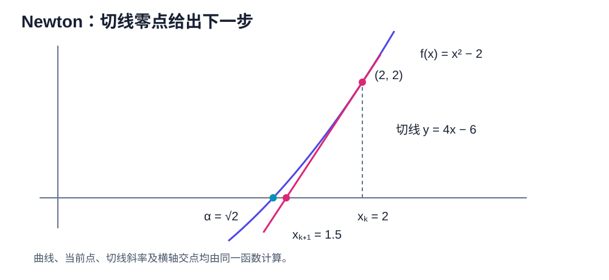

# Newton's Method & Convergence Order

牛顿法（Newton's method）是局部线性化产生的求根方法。本章先从泰勒定理（Taylor theorem）推导迭代式，再严格证明简单根附近的局部二次收敛，并分析重根、割线法和斯特芬森加速（Steffensen acceleration）。

## 求根问题

<figure markdown="span">
  
  <figcaption markdown="span">牛顿步不是任意公式：它把 $f$ 在 $x_k$ 处线性化，并取这条切线的零点作为 $x_{k+1}$。</figcaption>
</figure>

目标是求 $f(x)=0$ 的根 $\alpha$。当前近似为 $x_k$。在 $x_k$ 附近使用一阶泰勒近似（Taylor approximation）：

$$
f(x)\approx f(x_k)+f'(x_k)(x-x_k).
$$

令近似式在 $x_{k+1}$ 为零：

$$
0=f(x_k)+f'(x_k)(x_{k+1}-x_k).
$$

若 $f'(x_k)\ne0$，得到牛顿迭代（Newton iteration）：

$$
\boxed{x_{k+1}=x_k-\frac{f(x_k)}{f'(x_k)}}.
$$

实际实现中必须检查分母。$f'(x_k)$ 很小时，牛顿步（Newton step）可能非常大。

## 平方根示例

求 $\sqrt a$ 等价于解 $f(x)=x^2-a=0$。牛顿迭代为

$$
x_{k+1}
=x_k-\frac{x_k^2-a}{2x_k}
=\frac12\left(x_k+\frac a{x_k}\right).
$$

对 $a=2$、$x_0=1$：

$$
x_1=1.5,
\quad
x_2=\frac{17}{12}\approx1.41667,
\quad
x_3\approx1.41422.
$$

这是数值现象；收敛性还需要证明。

## 收敛阶

设 $e_k=x_k-\alpha$。以下定义针对没有在有限步精确命中根、因而 $e_k$ 最终非零的序列；有限步命中通常单独称为有限终止。若 $e_k\to0$，且存在 $p\ge1$、$C\in(0,\infty)$ 使

$$
\lim_{k\to\infty}\frac{|e_{k+1}|}{|e_k|^p}=C,
$$

则收敛阶为 $p$，$C$ 是渐近误差常数（asymptotic error constant）。

- $p=1$ 且 $C<1$：线性收敛（linear convergence）；
- $1<p<2$：超线性收敛（superlinear convergence）；
- $p=2$：二次收敛（quadratic convergence）。

若极限为零，实际阶数可能高于 $p$；若只知道 $|e_{k+1}|\le C|e_k|^p$，通常只能得到至少 $p$ 阶的控制。

## 局部二次收敛定理

**定理。** 设 $f$ 在根 $\alpha$ 的某邻域中二次连续可微，满足

$$
f(\alpha)=0,
\qquad
f'(\alpha)\ne0.
$$

则存在 $\alpha$ 的一个闭邻域 $I$，使任意 $x_0\in I$ 产生的牛顿迭代都有定义并收敛到 $\alpha$。此外存在 $C>0$ 使

$$
|e_{k+1}|\le C|e_k|^2.
$$

若进一步 $f''(\alpha)\ne0$，则

$$
\lim_{k\to\infty}
\frac{e_{k+1}}{e_k^2}
=\frac{f''(\alpha)}{2f'(\alpha)},
$$

故收敛阶恰为 $2$。

??? proof "证明"

    **误差恒等式。** 以 $x_k$ 为展开点，对根 $\alpha$ 使用带拉格朗日余项的泰勒定理：存在 $\xi_k$ 位于 $x_k$ 与 $\alpha$ 之间，使

    $$
    0=f(\alpha)
    =f(x_k)+f'(x_k)(\alpha-x_k)
    +\frac12f''(\xi_k)(\alpha-x_k)^2.
    $$

    除以 $f'(x_k)$ 并整理：

    $$
    \alpha-\left(x_k-\frac{f(x_k)}{f'(x_k)}\right)
    =-\frac{f''(\xi_k)}{2f'(x_k)}(\alpha-x_k)^2.
    $$

    括号内正是 $x_{k+1}$，且 $e_k=x_k-\alpha$，所以

    $$
    e_{k+1}
    =\frac{f''(\xi_k)}{2f'(x_k)}e_k^2.
    $$

    **构造不变邻域。** 因为 $f'(\alpha)\ne0$ 且 $f'$ 连续，可取半径 $r_0>0$ 和常数 $m>0$，使

    $$
    |f'(x)|\ge m
    $$

    在 $I_0=[\alpha-r_0,\alpha+r_0]$ 上成立。又因 $f''$ 连续，在紧区间上有界：存在 $M\ge0$ 使 $|f''(x)|\le M$。于是

    $$
    |e_{k+1}|\le\frac{M}{2m}|e_k|^2.
    $$

    记 $C=M/(2m)$。若 $C=0$，上式给出 $e_{k+1}=0$。若 $C>0$，取

    $$
    r\le\min\{r_0,1/(2C)\}.
    $$

    当 $|e_k|\le r$ 时，

    $$
    |e_{k+1}|
    \le C|e_k|^2
    \le Cr|e_k|
    \le\frac12|e_k|
    \le r.
    $$

    数学归纳法说明所有迭代点都留在该邻域内，分母始终非零，并且 $|e_k|\le2^{-k}|e_0|\to0$。

    **计算渐近常数。** 因为 $x_k\to\alpha$，夹在 $x_k$ 与 $\alpha$ 之间的 $\xi_k$ 也趋于 $\alpha$。由连续性，

    以下的商 $e_{k+1}/e_k^2$ 只讨论误差始终非零的迭代序列。若某一步 $e_k=0$，则 $x_k=\alpha$ 已精确命中根，算法在有限步成功终止；此时不再用后续商定义渐近阶。

    $$
    \frac{e_{k+1}}{e_k^2}
    =\frac{f''(\xi_k)}{2f'(x_k)}
    \longrightarrow\frac{f''(\alpha)}{2f'(\alpha)}.
    $$

    若 $f''(\alpha)\ne0$，该极限非零，所以收敛阶恰为二阶。

## 平方根迭代的精确误差

**命题。** 对 $a>0$ 和 $x_0>0$，平方根牛顿迭代从第一步起单调下降到 $\alpha=\sqrt a$，并满足精确误差关系

$$
e_{k+1}=\frac{e_k^2}{2x_k}.
$$

??? proof "证明"

    令 $\alpha=\sqrt a>0$。由

    $$
    x_{k+1}=\frac12\left(x_k+\frac{\alpha^2}{x_k}\right)
    $$

    可直接得到

    $$
    \begin{aligned}
    e_{k+1}
    &=\frac{x_k^2+\alpha^2-2\alpha x_k}{2x_k}\\
    &=\frac{(x_k-\alpha)^2}{2x_k}\\
    &=\frac{e_k^2}{2x_k}.
    \end{aligned}
    $$

    由算术－几何平均不等式，$x_1=(x_0+\alpha^2/x_0)/2\ge\alpha$。当 $x_k\ge\alpha$ 时，

    $$
    x_{k+1}-\alpha=\frac{(x_k-\alpha)^2}{2x_k}\ge0
    $$

    且

    $$
    x_{k+1}-x_k=\frac{\alpha^2-x_k^2}{2x_k}\le0.
    $$

    因此 $(x_k)_{k\ge1}$ 单调递减且下界为 $\alpha$，所以收敛到某个 $L\ge\alpha$。对迭代式取极限，得到 $L=(L+\alpha^2/L)/2$，即 $L^2=\alpha^2$。因 $L>0$，只能有 $L=\alpha$。最后，

    $$
    \frac{e_{k+1}}{e_k^2}=\frac1{2x_k}\to\frac1{2\alpha}\ne0,
    $$

    所以收敛阶恰为二阶。

## 重根

对多项式，$\alpha$ 是重数 $m\ge2$ 的根，表示 $(x-\alpha)^m$ 整除 $f$ 而 $(x-\alpha)^{m+1}$ 不整除。对一般函数，下面假设 $f$ 在邻域中至少 $m+1$ 次连续可微，并满足 $f(\alpha)=\cdots=f^{(m-1)}(\alpha)=0$、$f^{(m)}(\alpha)\ne0$；Taylor 因式分解给出

$$
f(x)=(x-\alpha)^m h(x),
\qquad h(\alpha)\ne0.
$$

标准牛顿法的渐近误差满足

$$
e_{k+1}=\frac{m-1}{m}e_k+O(e_k^2),
$$

所以只线性收敛。

??? proof "重根误差公式的证明"

    记 $e_k=x_k-\alpha$。由

    $$
    f(x_k)=e_k^m h(x_k),
    $$

    以及乘积求导法则，

    $$
    f'(x_k)=e_k^{m-1}\bigl(mh(x_k)+e_kh'(x_k)\bigr).
    $$

    代入牛顿公式，

    $$
    \begin{aligned}
    e_{k+1}
    &=e_k-\frac{e_k^m h(x_k)}
    {e_k^{m-1}(mh(x_k)+e_kh'(x_k))}\\
    &=e_k\frac{(m-1)h(x_k)+e_kh'(x_k)}
    {mh(x_k)+e_kh'(x_k)}.
    \end{aligned}
    $$

    当 $e_k\to0$ 时，$h(x_k)\to h(\alpha)\ne0$，所以分式趋于 $(m-1)/m$。把分式在 $e_k=0$ 附近展开，便得到

    $$
    e_{k+1}=\frac{m-1}{m}e_k+O(e_k^2).
    $$

以 $f(x)=(x-1)^3$ 为例，

$$
x_{k+1}
=x_k-\frac{(x_k-1)^3}{3(x_k-1)^2}
=1+\frac23(x_k-1),
$$

故 $e_{k+1}=(2/3)e_k$。

若已知重数 $m$，修正牛顿法（modified Newton method）

$$
x_{k+1}=x_k-m\frac{f(x_k)}{f'(x_k)}
$$

可恢复局部二次收敛。

??? proof "修正牛顿法恢复二次收敛的证明"

    使用上面的 $f$ 与 $f'$ 表达式，修正迭代的误差满足

    $$
    \begin{aligned}
    e_{k+1}
    &=e_k-m\frac{e_k^m h(x_k)}
    {e_k^{m-1}(mh(x_k)+e_kh'(x_k))}\\
    &=e_k^2\frac{h'(x_k)}{mh(x_k)+e_kh'(x_k)}.
    \end{aligned}
    $$

    分母趋于 $mh(\alpha)\ne0$，所以存在邻域和常数 $C$ 使

    $$
    |e_{k+1}|\le C|e_k|^2.
    $$

    若 $h'(\alpha)\ne0$，相应二次系数非零，收敛阶恰为二阶；若 $h'(\alpha)=0$，阶数可能更高。

## 全局失效示例

对

$$
f(x)=x^3-2x+2,
$$

从 $x_0=0$ 出发，

$$
x_1=0-\frac2{-2}=1,
$$

$$
x_2=1-\frac1{1}=0.
$$

迭代进入周期 $0\leftrightarrow1$，不会趋向实根。这说明局部二次收敛不等于任意初值全局收敛。

## 割线法（Secant Method）

割线法用割线斜率代替导数：

$$
f'(x_k)\approx
\frac{f(x_k)-f(x_{k-1})}{x_k-x_{k-1}}.
$$

得到

$$
\boxed{
x_{k+1}=x_k-f(x_k)
\frac{x_k-x_{k-1}}{f(x_k)-f(x_{k-1})}
}.
$$

要求 $x_k\ne x_{k-1}$ 且 $f(x_k)\ne f(x_{k-1})$。

**定理。** 设 $f$ 在简单根 $\alpha$ 附近二次连续可微，且 $f''(\alpha)\ne0$。若两个不同的初值充分接近 $\alpha$，则在没有提前命中根时割线迭代均有定义、收敛到 $\alpha$，并满足

$$
e_{k+1}
=\frac{f''(\alpha)}{2f'(\alpha)}e_ke_{k-1}
+o(e_ke_{k-1}).
$$

其对数意义下的收敛阶为黄金分割数

$$
p=\frac{1+\sqrt5}{2}\approx1.618.
$$

??? proof "证明"

    使用一阶和二阶差商记号

    $$
    f[x,y]=\frac{f(x)-f(y)}{x-y},
    \qquad
    f[x,y,z]=\frac{f[x,y]-f[y,z]}{x-z}.
    $$

    因为 $f(\alpha)=0$，割线公式可整理为精确误差恒等式

    $$
    e_{k+1}
    =\frac{f[x_k,x_{k-1},\alpha]}
    {f[x_k,x_{k-1}]}
    e_ke_{k-1}.
    $$

    下面证明所需的差商极限，而不把“连续延拓”作为未说明的结论。由中值定理，两个不同点 $x,y$ 之间存在 $\xi$，使

    $$
    f[x,y]=f'(\xi).
    $$

    当 $x,y\to\alpha$ 时，$\xi\to\alpha$，故 $f[x,y]\to f'(\alpha)$。

    对三个互异点 $x,y,z$，令 $q$ 是通过 $(x,f(x))$、$(y,f(y))$、$(z,f(z))$ 的二次插值多项式。函数 $f-q$ 有三个零点；连续使用两次罗尔定理，存在位于三点所张成区间内的 $\eta$，使 $(f-q)''(\eta)=0$。而二次插值式的最高次项系数正是 $f[x,y,z]$，所以

    $$
    2f[x,y,z]=q''(\eta)=f''(\eta).
    $$

    点重合的情形由极限取得。当 $x,y,z\to\alpha$ 时，$\eta\to\alpha$；由 $f''$ 连续，便得到

    $$
    f[x_k,x_{k-1}]\to f'(\alpha),
    \qquad
    f[x_k,x_{k-1},\alpha]\to\frac12f''(\alpha).
    $$

    因此系数趋于非零常数

    $$
    L=\frac{f''(\alpha)}{2f'(\alpha)},
    $$

    从而得到所述主误差关系。因为一阶差商趋于 $f'(\alpha)\ne0$，缩小邻域后分母不会为零；若某一步恰好命中根，算法已经完成。在其余情形，系数绝对值有统一上界 $K$。选邻域半径 $\delta$ 使 $c=K\delta<1$。若相邻两个误差都不超过 $\delta$，则

    $$
    |e_{k+1}|\le K|e_k||e_{k-1}|
    \le c\max\{|e_k|,|e_{k-1}|\}.
    $$

    令 $M_k=\max\{|e_k|,|e_{k-1}|\}$。上式先给出 $M_{k+1}\le M_k\le\delta$；再应用一次同一估计可得

    $$
    M_{k+2}\le cM_k.
    $$

    因此 $M_{2j}\le c^jM_0\to0$，奇数指标同理；迭代始终留在邻域内且 $e_k\to0$。

    为严格计算阶数，令 $a_k=|e_k|$、$s_k=-\log a_k$。由系数趋于 $|L|>0$，

    $$
    s_{k+1}=s_k+s_{k-1}+O(1).
    $$

    写 $d_k=s_{k+1}-s_k-s_{k-1}$，则 $d_k$ 收敛到常数 $-\log|L|$。采用 $F_0=0,F_1=1$ 的约定，逐次代入递推式得到

    $$
    \boxed{
    s_k=F_ks_1+F_{k-1}s_0
    +\sum_{j=1}^{k-1}F_{k-j}d_j
    }.
    $$

    例如 $k=2$ 时右侧为 $s_1+s_0+d_1=s_2$，下标与原递推一致。这个公式可对 $k$ 作归纳证明：假设它对 $k$ 和 $k-1$ 成立，把两式相加并加上 $d_k$，再使用 $F_{j+1}=F_j+F_{j-1}$，就得到 $k+1$ 的公式。

    下面补全比值极限，而不使用“主项不会抵消”的口头判断。因为 $a_k\to0$，所以 $s_k\to\infty$；又因为 $d_k$ 收敛，所以它有界。对充分大的 $k$ 定义

    $$
    r_k=\frac{s_k}{s_{k-1}}>0.
    $$

    将递推式除以 $s_k$ 得

    $$
    r_{k+1}=1+\frac1{r_k}+\varepsilon_k,
    \qquad
    \varepsilon_k=\frac{d_k}{s_k}\longrightarrow0.
    $$

    充分大时 $|\varepsilon_k|<1/2$，因此 $r_{k+1}>1/2$；再迭代一步可见后续比值落在某个固定紧区间，例如 $[1/2,4]$。把相邻两步合并：

    $$
    r_{k+2}=G(r_k)+o(1),
    \qquad
    G(r)=1+\frac1{1+1/r}=\frac{2r+1}{r+1}.
    $$

    在 $[1/2,4]$ 上，

    $$
    |G'(r)|=\frac1{(r+1)^2}\le\frac49<1.
    $$

    因而带有趋零扰动的两步迭代仍收敛到 $G$ 在正半轴上的唯一不动点。具体地，对奇数或偶数子序列分别记误差为 $u_j$，就有 $|u_{j+1}|\le(4/9)|u_j|+\eta_j$，其中 $\eta_j\to0$；取上极限得到 $\limsup|u_j|\le(4/9)\limsup|u_j|$，故上极限只能为零。于是奇、偶两个子序列都趋向同一个正根，而

    $$
    r=G(r)
    \iff r^2-r-1=0
    \iff r=\varphi=\frac{1+\sqrt5}{2}.
    $$

    所以

    $$
    \frac{s_{k+1}}{s_k}\longrightarrow
    \frac{1+\sqrt5}{2}.
    $$

    这就是割线法严格的对数收敛阶。它避免了未经证明地假设某个误差比极限必然存在。

## 斯特芬森加速（Steffensen Acceleration）

设不动点迭代 $x_{k+1}=g(x_k)$，固定点为 $\alpha$。定义

$$
y=g(x),
\qquad
z=g(y),
$$

斯特芬森映射（Steffensen map）为

$$
G(x)=x-\frac{(y-x)^2}{z-2y+x},
$$

前提是分母非零。

**定理。** 若 $g$ 在不动点 $\alpha$ 附近三次连续可微，且 $g'(\alpha)\ne1$，则斯特芬森迭代至少局部二次收敛；当下面推导出的二次系数非零时，收敛阶恰为二阶。

??? proof "证明"

    设 $g$ 三次连续可微，且

    $$
    g(\alpha+e)
    =\alpha+ae+be^2+O(e^3),
    $$

    其中 $a=g'(\alpha)$、$b=g''(\alpha)/2$。则

    $$
    y-x=(a-1)e+be^2+O(e^3),
    $$

    并且

    $$
    z-2y+x=(a-1)^2e+b(a^2+a-2)e^2+O(e^3).
    $$

    当 $a\ne1$ 时，可约去一阶因子并展开分式，得到

    $$
    G(\alpha+e)-\alpha
    =\frac{ab}{a-1}e^2+O(e^3).
    $$

    分母除以 $e$ 后趋于 $(a-1)^2>0$，所以存在穿孔邻域，在其中分母非零且映射有定义。再由 $|G(\alpha+e)-\alpha|\le C|e|^2$ 选取足够小的 $r$ 使 $Cr<1$，即可保证 $|e|\le r$ 时下一误差仍在该邻域并严格缩小。归纳得到局部收敛。若 $ab\ne0$，二次系数非零，阶数恰为二阶；若二次系数为零，阶数可能更高。若 $a=1$，分母的一阶项消失，不能套用上述结论。

## 多元牛顿法（Multivariate Newton Method）

对 $F:\mathbb R^n\to\mathbb R^n$，一阶线性化为

$$
F(x_k+s)\approx F(x_k)+J_F(x_k)s.
$$

令右侧为零，牛顿步 $s_k$ 由线性方程

$$
J_F(x_k)s_k=-F(x_k)
$$

确定，再令 $x_{k+1}=x_k+s_k$。数值实现应求解线性方程，不应显式形成 $J_F(x_k)^{-1}$。

对于优化问题 $\min f(x)$，求解的是 $\nabla f(x)=0$，因此牛顿步满足

$$
\nabla^2f(x_k)s_k=-\nabla f(x_k).
$$

根求解与优化形式相似，但对象不同。

### 二元方程组计算

求解

$$
F(x,y)=\begin{pmatrix}x^2+y^2-1\\x-y\end{pmatrix}=0,
$$

取初值 $(x_0,y_0)=(0.8,0.6)$。Jacobian 为

$$
J_F(x,y)=\begin{pmatrix}2x&2y\\1&-1\end{pmatrix}.
$$

在初值处 $F(x_0,y_0)=(0,0.2)^T$，Newton 步不是先求逆矩阵，而是解

$$
\begin{pmatrix}1.6&1.2\\1&-1\end{pmatrix}
\begin{pmatrix}\Delta x\\\Delta y\end{pmatrix}
=
\begin{pmatrix}0\\-0.2\end{pmatrix}.
$$

第二式给出 $\Delta x-\Delta y=-0.2$；代入第一式得 $\Delta y=4/35\approx0.114286$、$\Delta x=-3/35\approx-0.085714$。因此

$$
x_1=5/7\approx0.714286,\qquad y_1=5/7\approx0.714286.
$$

此时第二个方程已经精确满足，而第一个残差为 $2(5/7)^2-1=1/49$。下一步继续解新的 $2\times2$ 线性方程即可。实际程序使用带主元的线性求解器；显式计算 $J_F^{-1}$ 既多做运算，也通常放大舍入误差。

## 练习

1. 对 $f(x)=x^2-3$、$x_0=2$ 计算两次牛顿迭代。
2. 对 $f(x)=x^2$ 证明标准牛顿法只线性收敛。
3. 从泰勒余项（Taylor remainder）重新证明 $|e_{k+1}|\le M|e_k|^2/(2m)$。
4. 对 $f(x)=(x-2)^4$ 推导标准牛顿迭代的误差因子，并写出已知重数时的修正方法。
5. 验证 $g(x)=\cos x$ 的斯特芬森迭代在其固定点附近满足二阶条件。

??? tip "第一步提示"

    第 1 题逐次代入公式。第 2、4 题先把根平移到误差变量 $e_k$。第 3 题照局部定理的“误差恒等式—不变邻域”顺序。第 5 题先求固定点处的 $g'$ 与 $g''$。

**答案。** 第 1 题 $x_1=7/4$、$x_2=97/56$。第 2 题 $x_{k+1}=x_k/2$。第 4 题 $e_{k+1}=3e_k/4$，修正方法使用系数 $4$。

**上一章：** [不动点与压缩映射](04-fixed-points-contractions.md)  
**下一章：** [丘赛真题](06-stage-one-workbook.md)

